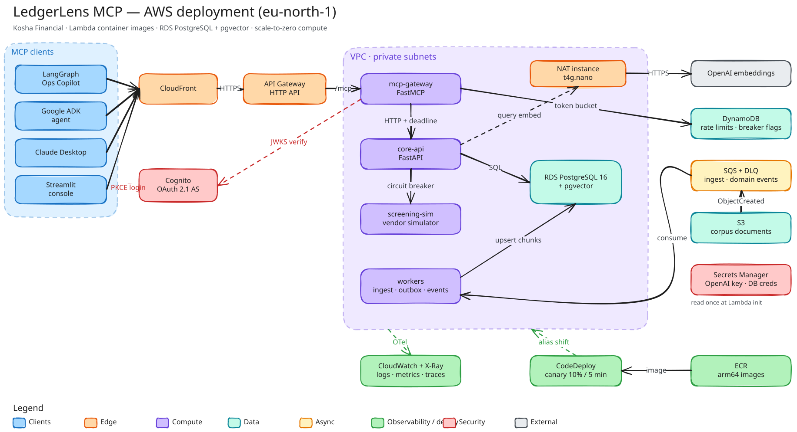

<div align="center">

# LedgerLens MCP

**A production-grade [Model Context Protocol](https://modelcontextprotocol.io) server for a fictional Indian neobank — built the way a regulated fintech would build it.**

[](https://github.com/sourav-dhar/ledgerlens-mcp/actions/workflows/ci.yml)
[](https://sourav-dhar.github.io/ledgerlens-mcp/)
[](https://github.com/sourav-dhar/ledgerlens-mcp/releases)
[](https://www.python.org/)
[](https://github.com/astral-sh/uv)
[](https://github.com/astral-sh/ruff)
[](https://github.com/microsoft/pyright)
[](LICENSE)

[**Documentation**](https://sourav-dhar.github.io/ledgerlens-mcp/) · [Architecture](https://sourav-dhar.github.io/ledgerlens-mcp/architecture/hld/) · [Decisions](docs/adr/index.md) · [Glossary](GLOSSARY.md)

</div>

---

AI agents connect to LedgerLens to investigate **customers, payments, KYC and AML alerts** at *Kosha Financial*, take **audited, idempotent write actions**, and search **85 internal SOPs and policies** with cited, permission-aware hybrid retrieval. Every piece of data is synthetic but regulator-realistic: UPI, IMPS and NEFT rails, PAN and Aadhaar handling under the RBI KYC Master Direction, PMLA-style alert typologies.



## Highlights

| | |
|---|---|
| **OAuth 2.1 to the MCP spec** | Protected Resource Metadata (RFC 9728) discovery, Cognito, per-tool scopes, role-based PII masking, append-only audit log |
| **Resilience you can watch** | Deadline propagation, retries with jitter and budgets, circuit breakers, bulkheads, per-client rate limits, idempotency, chaos injection |
| **Hybrid RAG with citations** | pgvector + Postgres full-text fused by reciprocal rank fusion, row-level security on document classification, graceful degradation |
| **Serverless on AWS** | Lambda container images, CDK, keyless OIDC deploys, CodeDeploy canaries with automatic rollback |
| **Supply-chain hygiene** | SHA-pinned actions, digest-pinned images, Trivy and pip-audit gates, gitleaks, Dependabot with cooldown, protected `main` |

## Build progress

Delivered in phases; each phase lands as one reviewed pull request with green CI. Full plan: [`docs/plans/v1.0-architecture.md`](docs/plans/v1.0-architecture.md).

| Phase | Scope | Status |
|---|---|---|
| **P0** | Repository, uv workspace, CI/CD, hardened Docker image, design docs, ADRs | ✅ [v0.2.0](https://github.com/sourav-dhar/ledgerlens-mcp/releases/tag/v0.2.0) |
| **P1** | Deterministic synthetic data generator, PostgreSQL schema and migrations | ⏳ next |
| P2 | Core Banking API: customers, accounts, ledger, KYC, AML, disputes | |
| P3 | MCP gateway: tools, resources, prompts, OAuth, masking, audit | |
| P4 | Resilience toolkit, chaos mode, screening vendor simulator | |
| P5 | SOP corpus, SQS ingestion pipeline, hybrid retrieval, RAG evals | |
| P6 | AWS CDK, OIDC deploys, CodeDeploy canaries, end-to-end and load tests | |
| P7 | LangGraph and Google ADK agents, Streamlit console, demo | |
| P8 | Showcase polish: animated infographics, docs site, walkthrough | |

## Quick start

Requires [uv](https://docs.astral.sh/uv/) and Docker.

```bash
git clone https://github.com/sourav-dhar/ledgerlens-mcp && cd ledgerlens-mcp
uv sync --all-packages          # Python 3.13 and every workspace package
uv run poe check                # lint, strict type check, tests
uv run poe up                   # gateway :8700 · core API :8701 · screening sim :8702
```

Call a tool over MCP Streamable HTTP:

```bash
curl -s localhost:8700/mcp \
  -H 'Content-Type: application/json' -H 'Accept: application/json, text/event-stream' \
  -d '{"jsonrpc":"2.0","id":1,"method":"tools/call","params":{"name":"get_service_health","arguments":{}}}'
```

## Repository layout

```
services/      core-api (FastAPI) · mcp-gateway (FastMCP) · screening-sim (FastAPI)
docker/        one multi-stage image recipe for every service (Lambda Web Adapter)
docs/          plans · architecture (HLD + 9 LLDs) · ADRs · diagrams · MkDocs site
.github/       CI, docs, release workflows · Dependabot · templates
```

## Engineering standards

- **Test-first**, with a failure matrix per tool (auth, scopes, masking, timeouts, breaker open, rate limits, idempotency).
- **Strict gates:** ruff, pyright strict at zero errors, pytest with warnings as errors, ≥ 90% coverage per package.
- **Reproducible images:** code-only rebuilds in ~7 s via a bit-for-bit reproducible dependency layer; non-root, read-only, all capabilities dropped.
- **Decisions are written down:** [10 ADRs](docs/adr/index.md), a [domain glossary](GLOSSARY.md) and [versioned plans](docs/plans/CHANGELOG.md).

---

<sub>Kosha Financial, its staff and its customers are fictional; all data is synthetic. Real regulations are cited for realism only — nothing here is legal or compliance advice. MIT licensed.</sub>
