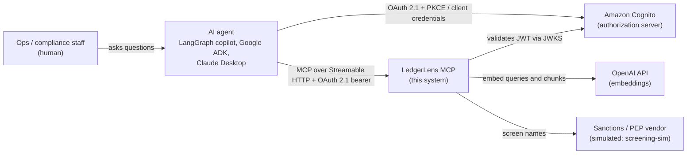
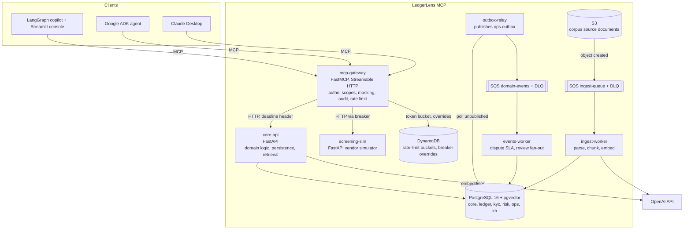
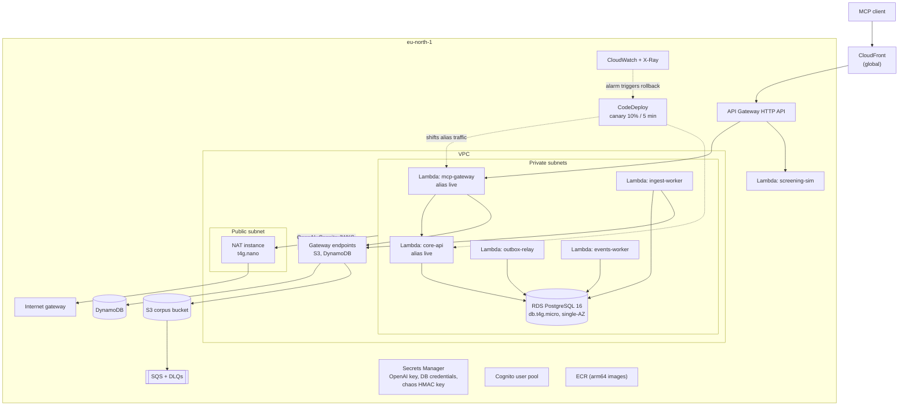
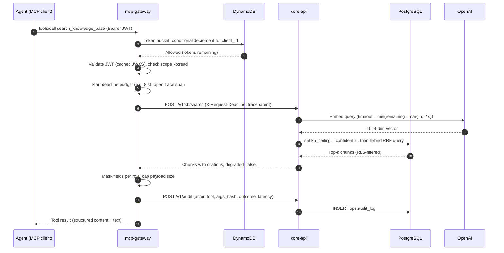
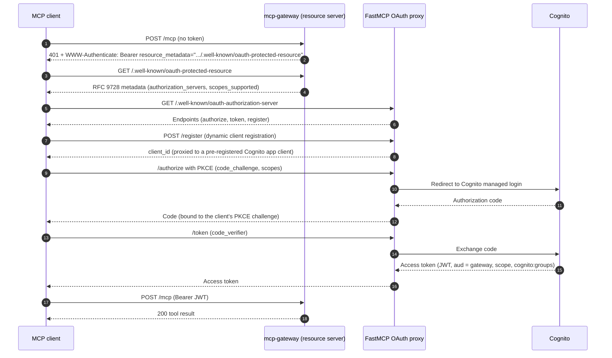

# High-Level Design

> Source of truth: [plan v1.0](../plans/v1.0-architecture.md). This document explains the shape; the plan records the decisions.

## 1. Purpose and scope

LedgerLens MCP lets AI agents work with Kosha Financial's operational data and internal knowledge through the Model Context Protocol:

| Capability | Tools |
|---|---|
| Customer & KYC lookup | `search_customers`, `get_customer_profile`, `get_kyc_status`, `list_kyc_documents` |
| Accounts & payments | `get_account_summary`, `search_transactions`, `get_transaction`, `get_spending_insights` |
| Risk & compliance | `list_aml_alerts`, `get_aml_alert`, `screen_entity` |
| Audited writes | `raise_dispute`, `flag_transaction_for_review` |
| Knowledge | `search_knowledge_base`, `get_document` |
| Operations | `get_service_health` |

Out of scope: moving real money, real customer data, multi-Region operation (not available to the project).

## 2. System context (C4 level 1)

*Notice: the agent never talks to data stores directly; every capability is mediated by one OAuth-protected MCP endpoint.*

## 3. Containers (C4 level 2)

*Notice: the gateway owns cross-cutting concerns (auth, masking, audit, rate limits); `core-api` owns all domain state; asynchronous work never blocks a tool call.*

| Container | Runtime | Owns |
|---|---|---|
| `mcp-gateway` | FastMCP on Lambda (Web Adapter) | Protocol, auth, authorization, masking, audit, rate limiting, resilience toward downstreams |
| `core-api` | FastAPI on Lambda (Web Adapter) | Domain rules, Postgres schemas, ledger, outbox, idempotency, hybrid retrieval |
| `screening-sim` | FastAPI on Lambda | Simulated external dependency with tunable latency and failure |
| `ingest-worker` | Lambda, SQS trigger | Document parsing, chunking, embedding, upsert |
| `outbox-relay` | Lambda, scheduled | Exactly-once-effect publication of domain events |
| `events-worker` | Lambda, SQS trigger | Dispute TAT timers, review queue fan-out |

## 4. Deployment view (AWS, `eu-north-1`)

*Notice: everything Regional is in `eu-north-1`; only CloudFront is global. S3 and DynamoDB traffic stays on free gateway endpoints; only internet-bound calls pay for the NAT instance.*

Network rules:

| From | To | Path |
|---|---|---|
| Lambdas in VPC | RDS | Security group to security group, port 5432 |
| Lambdas in VPC | S3, DynamoDB | Gateway VPC endpoints (no NAT cost) |
| Lambdas in VPC | OpenAI, Cognito JWKS, Secrets Manager, SQS | NAT instance |
| `screening-sim` | none | Runs outside the VPC; it has no private dependencies |

## 5. Request lifecycle

*Notice: every hop receives the remaining deadline, so a slow embedding call cannot push the overall request past its budget.*

If OpenAI fails or the deadline is too short for embedding, `core-api` runs the full-text half of the query only and returns `degraded: true`.

## 6. Authorization discovery

*Notice: Cognito does not support dynamic client registration, so FastMCP's OAuth proxy supplies it while Cognito stays the real identity provider. Service-to-service callers skip the browser flow and use client credentials.*

## 7. Quality attributes

| Attribute | Target | Mechanism | Verified by |
|---|---|---|---|
| Latency, simple reads | p95 < 300 ms warm | Indexed queries, connection reuse per instance, payload caps | Locust in CI against deployed stack |
| Latency, KB search | p95 < 900 ms | HNSW index, single SQL round trip, 1024-dim embeddings | Locust, RAG eval suite |
| Cold start | < 2.5 s | Slim arm64 images, lazy imports, no work at import time | Synthetic probe after deploy |
| Availability | 99.5% | Canary + rollback, breakers, degradation, retries with budget | CloudWatch SLO alarms |
| Fairness | 60 req/min/client, burst 20 | DynamoDB token bucket | Integration tests, Locust |
| Correctness of money | Ledger reconciles to the paisa | Double-entry postings, `BIGINT` paise, nightly reconciliation test | Property tests, reconciliation job |
| Confidentiality | No PII beyond scope | Scope checks, masking, RLS on KB classification | Per-tool failure matrix |

## 8. Cost (approximate, monthly, while running)

| Item | Cost |
|---|---|
| RDS PostgreSQL `db.t4g.micro` + 20 GB gp3 | ~$15 |
| NAT instance `t4g.nano` + public IPv4 | ~$7 |
| Lambda, API Gateway, CloudFront, SQS, DynamoDB at demo volume | ~$1 |
| Secrets Manager (3 secrets) | ~$1.20 |
| CloudWatch logs, metrics, X-Ray | ~$1 |
| **Total** | **≈ $25** |

`poe pause` stops RDS and the NAT instance between demos; `poe resume` starts them again.

## 9. Key trade-offs

| Decision | Alternative rejected | Why | ADR topic |
|---|---|---|---|
| Lambda container images | ECS Fargate | ~2.5x cheaper idle; same image runs anywhere | Compute platform |
| Separate gateway and core API | Single FastMCP process | Real network seam makes resilience patterns meaningful and keeps protocol concerns out of the domain | Service split |
| PostgreSQL as system of record | DynamoDB single-table | Ledger needs ACID, joins, aggregates; pgvector needs Postgres anyway | Datastore |
| pgvector + FTS hybrid in one query | OpenSearch Serverless, S3 Vectors | OpenSearch ~$170/month minimum; S3 Vectors unavailable on the plan | Vector store |
| NAT instance | NAT Gateway | ~$7 vs ~$33/month; single point of failure accepted for a demo | Egress |
| In-memory breakers + DynamoDB override | Fully shared breaker state | Avoids a network call per request; override covers fleet-wide incidents | Breaker state |
| In-app JWT validation | API Gateway JWT authorizer | Spec requires `WWW-Authenticate` with resource metadata on 401 | Auth placement |
| SQS + transactional outbox | Kafka / MSK | No streaming workload; MSK not on the plan | Messaging |
| CodeDeploy canary | All-at-once deploy | Alarm-driven automatic rollback | Deployment safety |
