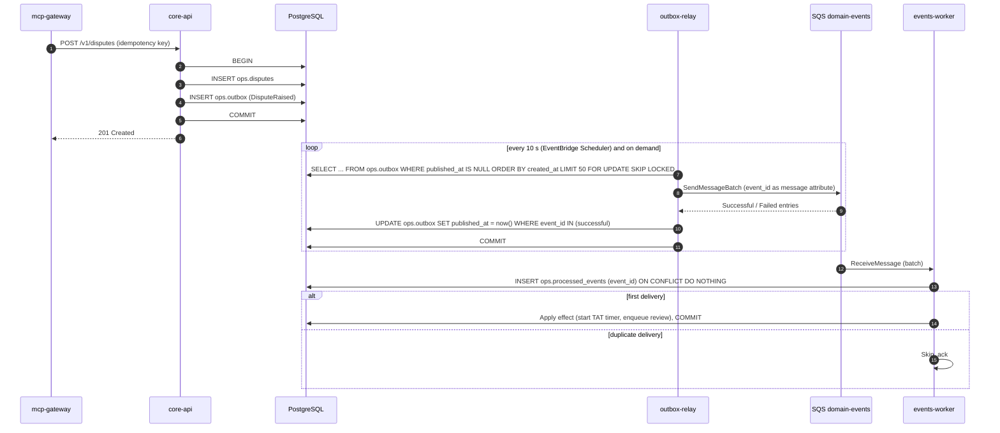
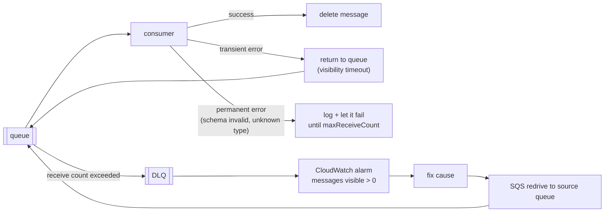

# LLD — Async messaging

Two asynchronous flows, both on Amazon SQS standard queues with dead-letter queues:

| Flow | Producer | Queue | Consumer |
|---|---|---|---|
| Document ingestion | S3 `ObjectCreated` notifications | `ingest-queue` → `ingest-dlq` | `ingest-worker` |
| Domain events | `outbox-relay` reading `ops.outbox` | `domain-events` → `domain-events-dlq` | `events-worker` |

Kafka is not used: there is no high-throughput streaming need, and MSK is not available on the project's plan.

## 1. Transactional outbox

A business write and the event announcing it must not diverge. Writing to SQS inside a database transaction cannot be atomic, so the event is written to `ops.outbox` in the same transaction and published afterwards.



*Notice: the relay may publish an event twice (crash after send, before marking), so the consumer, not the queue, guarantees the effect happens once.*

| Property | How it is achieved |
|---|---|
| No lost events | Event row commits with the business row |
| No phantom events | Rolled-back transactions leave no outbox row |
| Parallel relays are safe | `FOR UPDATE SKIP LOCKED` |
| Ordering | Best-effort by `created_at`; consumers do not depend on order (each event carries the full state they need) |
| Exactly-once effect | At-least-once delivery + `ops.processed_events` dedupe table keyed by `event_id` (Proposed (to validate in P2): table added to v0.2 schema) |

## 2. Event envelope

```json
{
  "event_id": "evt_01JD3K5Z8Q3W6X2N4P7R9T1V0B",
  "event_type": "DisputeRaised",
  "event_version": 1,
  "aggregate_type": "dispute",
  "aggregate_id": "dsp_01JD3K5Z7M2B8C4D6F8H0J2K4L",
  "occurred_at": "2026-11-12T09:14:03.512Z",
  "trace_id": "4bf92f3577b34da6a3ce929d0e0e4736",
  "payload": { "txn_id": "txn_...", "reason_code": "credit_not_received", "tat_due_at": "..." }
}
```

| Event | Emitted by | Consumer effect |
|---|---|---|
| `DisputeRaised` | `raise_dispute` | Compute TAT, schedule reminder, auto-reverse eligible `failed_but_debited` UPI disputes |
| `TransactionFlagged` | `flag_transaction_for_review` | Create review queue entry, escalate to AML when risk score ≥ threshold |
| `DocumentIngested` | `ingest-worker` | Refresh KB statistics for `get_service_health` |

`trace_id` carries the originating request's trace so an asynchronous effect appears in the same trace.

## 3. Queue configuration

| Setting | `ingest-queue` | `domain-events` | Reason |
|---|---|---|---|
| Visibility timeout | 360 s | 60 s | AWS guidance: at least 6 × the consumer Lambda timeout |
| Consumer Lambda timeout | 60 s | 10 s | |
| Batch size | 5 | 10 | |
| `ReportBatchItemFailures` | on | on | Only failed messages return to the queue |
| `maxReceiveCount` | 3 | 5 | Then moved to the DLQ |
| DLQ retention | 14 days | 14 days | Time to investigate and redrive |
| Encryption | SSE-SQS | SSE-SQS | |
| Long polling | 20 s | 20 s | Fewer empty receives |

## 4. Poison messages



*Notice: the DLQ is a holding area, not a graveyard; every DLQ message triggers an alarm and is redriven once the cause is fixed.*

| Error class | Example | Handling |
|---|---|---|
| Transient | OpenAI `429`, Postgres connection reset | Raise; message retried after visibility timeout |
| Permanent | Malformed envelope, unknown `event_type`, document without header block | Log with `event_id`, raise; reaches DLQ after `maxReceiveCount` |
| Duplicate | Same `event_id` delivered twice | Dedupe table; ack without effect |

## 5. Testing

| Test | Tooling |
|---|---|
| Outbox row written iff business row written (including rollback paths) | testcontainers Postgres |
| Relay publishes, marks, and tolerates send failures | LocalStack SQS |
| Consumer idempotency under duplicate delivery | LocalStack SQS, same message sent twice |
| Poison message reaches DLQ after N receives | LocalStack with short visibility timeout |
| Concurrent relays do not double-publish within one poll | Two relay tasks, `SKIP LOCKED` assertions |
