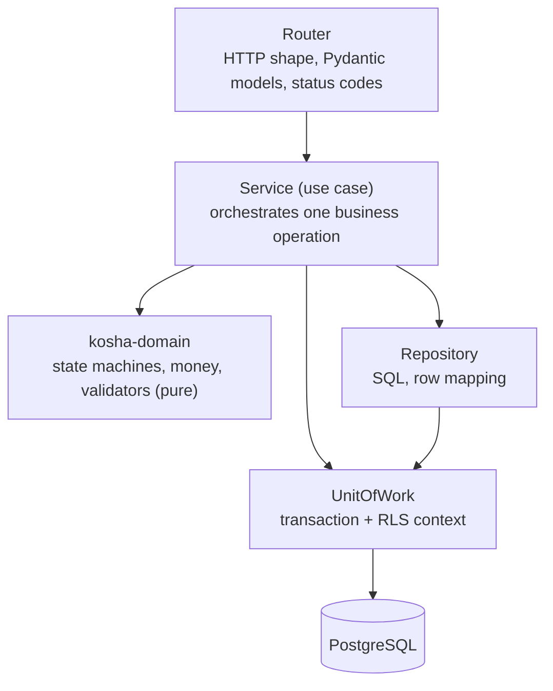
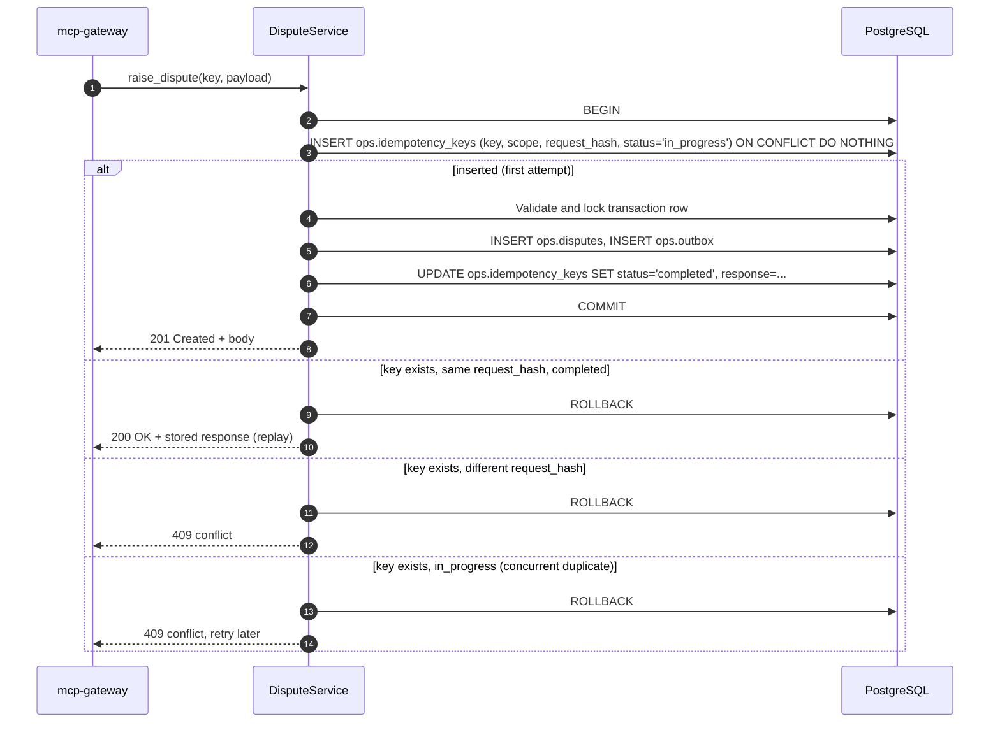

# LLD — `core-api`

`core-api` is the Core Banking API: a FastAPI service that owns every Postgres schema and all domain rules. It is only reachable from inside the VPC (the gateway and workers); it is not exposed through CloudFront.

## 1. Module structure

```
services/core-api/src/core_api/
├── app.py                 # create_app(settings) -> FastAPI; lifespan opens the pool
├── settings.py
├── db/
│   ├── pool.py            # psycopg 3 AsyncConnectionPool; min 0, max 2 per Lambda instance
│   ├── uow.py             # UnitOfWork: one transaction, SET LOCAL context, commit/rollback
│   └── rls.py             # set kosha.kb_ceiling, kosha.actor for RLS and audit
├── routers/
│   ├── customers.py       # /v1/customers
│   ├── accounts.py        # /v1/accounts, /v1/accounts/{id}/transactions
│   ├── transactions.py    # /v1/transactions/{id}
│   ├── insights.py        # /v1/accounts/{id}/insights
│   ├── kyc.py             # /v1/customers/{id}/kyc
│   ├── aml.py             # /v1/aml/alerts
│   ├── disputes.py        # /v1/disputes
│   ├── reviews.py         # /v1/reviews
│   ├── kb.py              # /v1/kb/search, /v1/kb/documents/{doc_code}
│   ├── audit.py           # /v1/audit
│   └── health.py          # /healthz (liveness), /readyz (pool + migration version)
├── repositories/          # one per aggregate; SQL lives here and only here
├── services/              # use cases: DisputeService, ReviewService, LedgerService
└── migrations/            # Alembic; forward-only in production
```

Domain types (money, identifiers, statuses, state machines, validators) come from `kosha-domain`, so the gateway and `core-api` share one definition.

## 2. Layering



*Notice: only repositories contain SQL and only the unit of work opens transactions; domain code is pure and has no I/O, so it is tested without a database.*

Read-only routes call repositories directly through a read-only unit of work (`SET TRANSACTION READ ONLY`). Write routes always go through a service.

## 3. Transaction boundaries

One HTTP request maps to at most one database transaction.

| Operation | Inside a single transaction |
|---|---|
| `POST /v1/disputes` | idempotency check → state-machine check on the transaction → insert `ops.disputes` → insert `ops.outbox` (`DisputeRaised`) → store idempotency response |
| `POST /v1/reviews` | idempotency check → insert `ops.transaction_reviews` → update `core.transactions.is_flagged` → insert `ops.outbox` (`TransactionFlagged`) → store idempotency response |
| `POST /v1/audit` | insert `ops.audit_log` (own short transaction; never joined with business writes) |
| Ledger posting (generator, reversals) | insert `ledger.journal_entries` → insert balanced `ledger.postings` → update `core.accounts` balances → insert `core.transaction_status_history` |

Isolation is `READ COMMITTED` with explicit row locks (`SELECT ... FOR UPDATE`) on the rows a write depends on.

## 4. Idempotency inside the transaction



*Notice: the idempotency record, the business row and the outbox event commit or roll back together, so a crash can never leave one without the others.*

`request_hash` is SHA-256 over the canonical JSON of the payload plus the actor's `sub`. Keys expire after 24 hours (cleaned by a scheduled job).

## 5. Ledger posting algorithm

Every money movement becomes one journal entry with postings that sum to zero.

| Transaction | Postings (paise) |
|---|---|
| UPI debit of ₹250 from customer account A | A: `-25000`; `UPI_SETTLEMENT`: `+25000` |
| Salary credit of ₹85,000 via NEFT | `NEFT_SETTLEMENT`: `-8500000`; A: `+8500000` |
| ₹10 SMS charges | A: `-1000`; `FEE_INCOME`: `+1000` |
| Quarterly interest ₹312.40 | `INTEREST_EXPENSE`: `-31240`; A: `+31240` |
| `credit_delayed` resolved by reversal | Reverse the original entry with an opposite entry; never update or delete postings |

```python
def post(entry: JournalEntry) -> None:
    if sum(p.amount_paise for p in entry.postings) != 0:
        raise UnbalancedEntry(entry.entry_id)
    # INSERT journal_entries; INSERT postings; UPDATE accounts SET ledger_balance_paise += delta
```

Database invariants backing the code:

| Invariant | Enforcement |
|---|---|
| Postings of an entry sum to zero, with at least two | Deferred constraint triggers on `ledger.postings` and `ledger.journal_entries` (the second catches an entry with no postings) |
| Postings, entries and status history are immutable | `UPDATE`/`DELETE` never granted to `kosha_app`, and `kosha.forbid_change()` rejects `UPDATE`, `DELETE` and `TRUNCATE` from anyone |
| Cached balance equals Σ postings | Reconciliation query run by tests and a scheduled job |
| Amounts are integers | `BIGINT`; `amount_paise > 0` on `core.transactions` |

## 6. Pagination and filtering

| Concern | Approach |
|---|---|
| Pagination | Keyset on `(initiated_at DESC, txn_id DESC)`; the gateway wraps the position in a signed cursor |
| Partition pruning | `initiated_at` range always present (defaulted to the last 90 days) so only relevant monthly partitions are scanned |
| Text filter | `narration ILIKE` backed by a `pg_trgm` GIN index |
| Page size | 1–100; the gateway also caps response bytes |
| Aggregates (`/insights`) | `GROUP BY date_trunc('month', initiated_at), category` over the partitioned table |

## 7. OpenAPI

FastAPI generates the OpenAPI 3.1 document. It is:

- snapshot-tested (`syrupy`) so any contract change is a reviewed diff;
- used to generate nothing: the gateway's client is hand-written against shared `kosha-domain` models, which keeps both sides typed without a codegen step;
- published on the docs site as the internal API reference.

| Status | Meaning |
|---|---|
| `200` / `201` | Success / created |
| `400` | Validation failed (`invalid_argument`) |
| `404` | Not found |
| `409` | Idempotency conflict or illegal state transition |
| `422` | Reserved for FastAPI request parsing errors, mapped to `invalid_argument` by the gateway |
| `503` | Pool exhausted or dependency unavailable (`Retry-After` set) |
| `504` | Deadline exceeded inside `core-api` |
