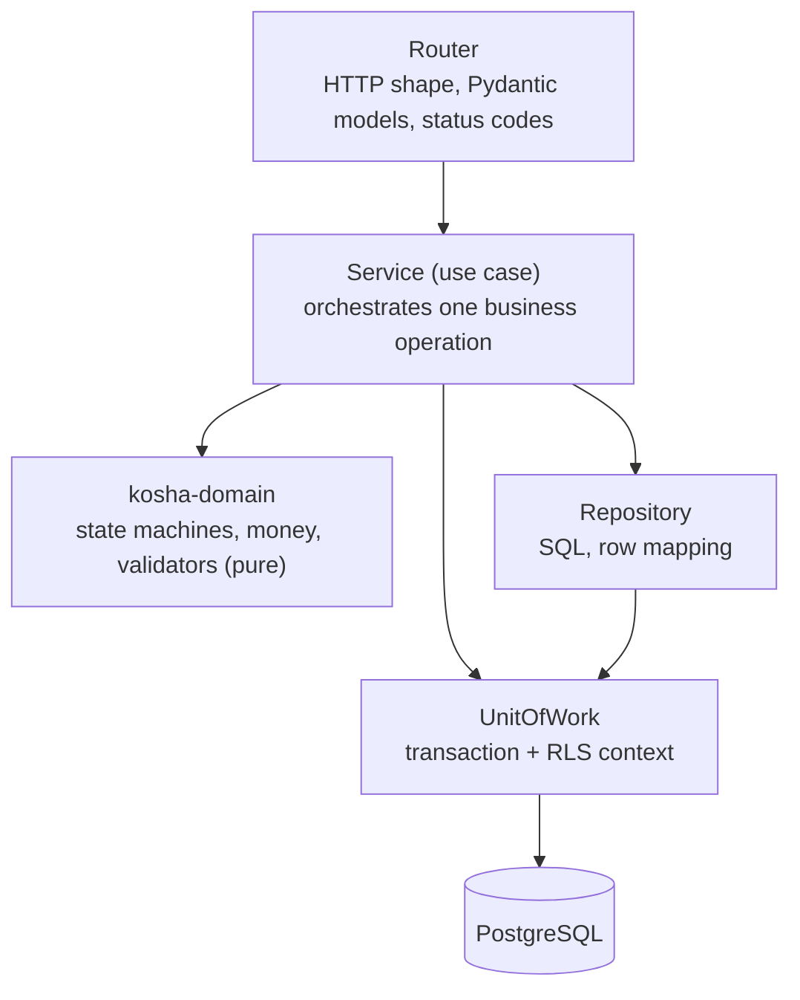
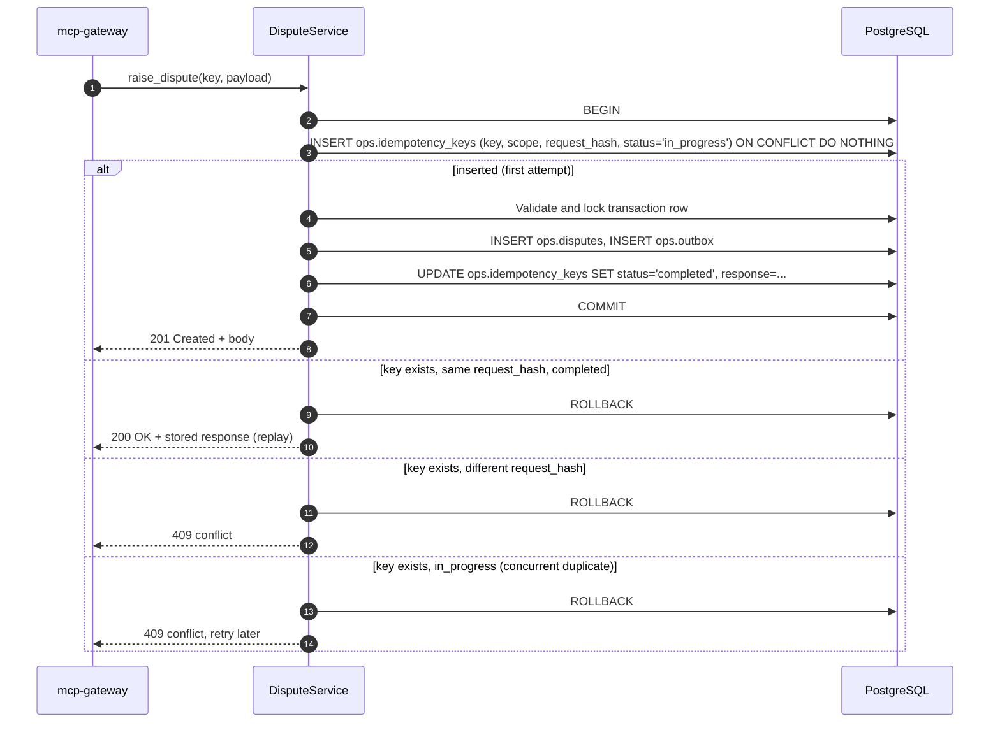

# LLD — `core-api`

`core-api` is the Core Banking API: a FastAPI service that owns every Postgres schema and all domain rules. It is only reachable from inside the VPC (the gateway and workers); it is not exposed through CloudFront.

## 1. Module structure

```
services/core-api/src/core_api/
├── app.py                 # create_app(settings) -> FastAPI; lifespan opens the pool
├── settings.py
├── deps.py                # Caller from the gateway's signed headers (ADR 0013); Database
├── errors.py              # ApiError family, database-error mapping, one error body
├── health.py              # /healthz (liveness), /readyz (database at the shipped revision)
├── db/
│   ├── database.py        # Database: AsyncConnectionPool (min 0, max 2) + unit_of_work
│   └── rls.py             # Caller; one set_config round trip: role, read-only, timeout, context
├── schemas/               # response models: the HTTP contract, snapshot-tested
├── routers/
│   ├── customers.py       # /v1/customers
│   ├── accounts.py        # /v1/accounts, /v1/accounts/{id}/transactions
│   ├── transactions.py    # /v1/transactions/{id}
│   ├── insights.py        # /v1/accounts/{id}/insights
│   ├── kyc.py             # /v1/customers/{id}/kyc
│   ├── aml.py             # /v1/aml/alerts
│   ├── disputes.py        # /v1/disputes
│   ├── reviews.py         # /v1/reviews
│   ├── kb.py              # /v1/kb/search, /v1/kb/documents/{doc_code}
│   └── audit.py           # /v1/audit
├── repositories/          # one per aggregate; SQL lives here and only here
├── services/              # use cases: DisputeService, ReviewService, LedgerService
└── migrations/            # Alembic; forward-only in production
```

Domain types (money, identifiers, statuses, state machines, validators) come from `kosha-domain`, so the gateway and `core-api` share one definition.

## 2. Layering



*Notice: only repositories contain SQL and only the unit of work opens transactions; domain code is pure and has no I/O, so it is tested without a database.*

Read-only routes call repositories directly through a read-only unit of work (`SET TRANSACTION READ ONLY`). Write routes always go through a service.

Every unit of work opens with one statement that sets, transaction-locally (`set_config(..., true)`):

| Setting | Value | Why |
|---|---|---|
| `role` | `kosha_app` | Grants, `forbid_change()` and row-level security apply even when the login role is the owner (locally, a superuser) |
| `transaction_read_only` | `on` for reads | A read route cannot write by mistake |
| `statement_timeout` | `DB_STATEMENT_TIMEOUT_MS` (3 s) | A runaway query answers `504` instead of holding the connection |
| `kosha.actor`, `kosha.kb_ceiling` | From the `X-Kosha-Actor` and `X-Kosha-Kb-Ceiling` headers, once their signature verifies (ADR 0013) | Audit and knowledge-base RLS; no ceiling means no KB rows |

Because each setting ends with the transaction, a pooled connection never carries one caller's identity into another's request.

## 3. Transaction boundaries

One HTTP request maps to at most one database transaction.

| Operation | Inside a single transaction |
|---|---|
| `POST /v1/disputes` | idempotency check → state-machine check on the transaction → insert `ops.disputes` → insert `ops.outbox` (`DisputeRaised`) → store idempotency response |
| `POST /v1/reviews` | idempotency check → insert `ops.transaction_reviews` → update `core.transactions.is_flagged` → insert `ops.outbox` (`TransactionFlagged`) → store idempotency response |
| `POST /v1/audit` | insert `ops.audit_log` (own short transaction; never joined with business writes) |
| Ledger posting (generator, reversals) | insert `ledger.journal_entries` → insert balanced `ledger.postings` → update `core.accounts` balances → insert `core.transaction_status_history` |

Isolation is `READ COMMITTED` with explicit row locks (`SELECT ... FOR UPDATE`) on the rows a write depends on.

## 4. Idempotency inside the transaction



*Notice: the idempotency record, the business row and the outbox event commit or roll back together, so a crash can never leave one without the others.*

`request_hash` is SHA-256 over the canonical JSON of the payload plus the actor's `sub`. Keys expire after 24 hours (cleaned by a scheduled job).

## 5. Ledger posting algorithm

Every money movement becomes one journal entry with postings that sum to zero.

| Transaction | Postings (paise) |
|---|---|
| UPI debit of ₹250 from customer account A | A: `-25000`; `UPI_SETTLEMENT`: `+25000` |
| Salary credit of ₹85,000 via NEFT | `NEFT_SETTLEMENT`: `-8500000`; A: `+8500000` |
| ₹10 SMS charges | A: `-1000`; `FEE_INCOME`: `+1000` |
| Quarterly interest ₹312.40 | `INTEREST_EXPENSE`: `-31240`; A: `+31240` |
| `credit_delayed` resolved by reversal | A `reversal` credit Transaction whose entry mirrors the original; postings are never updated or deleted |
| Balance brought forward (Account older than the ledger) | A: `+4250000`; `OPENING_BALANCES`: `-4250000`, an entry with no Transaction |

```python
def post(entry: JournalEntry) -> None:
    if sum(p.amount_paise for p in entry.postings) != 0:
        raise UnbalancedEntry(entry.entry_id)
    # INSERT journal_entries; INSERT postings; UPDATE accounts SET ledger_balance_paise += delta
```

Database invariants backing the code:

| Invariant | Enforcement |
|---|---|
| Postings of an entry sum to zero, with at least two | Deferred constraint triggers on `ledger.postings` and `ledger.journal_entries` (the second catches an entry with no postings) |
| Postings, entries and status history are immutable | `UPDATE`/`DELETE` never granted to `kosha_app`, and `kosha.forbid_change()` rejects `UPDATE`, `DELETE` and `TRUNCATE` from anyone |
| Cached balance equals Σ postings | `ledger.account_reconciliation` view: any non-zero `difference_paise` is a defect; `poe seed` and a scheduled job check it |
| Amounts are integers | `BIGINT`; `amount_paise > 0` on `core.transactions` |

## 6. Pagination and filtering

| Concern | Approach |
|---|---|
| Pagination | Keyset on `(initiated_at DESC, txn_id DESC)`; the gateway wraps the position in a signed cursor |
| Partition pruning | `initiated_at` range always present (defaulted to the last 90 days) so only relevant monthly partitions are scanned |
| Text filter | `narration ILIKE` backed by a `pg_trgm` GIN index |
| Page size | 1–100; the gateway also caps response bytes |
| Aggregates (`/insights`) | `GROUP BY date_trunc('month', initiated_at), category` over the partitioned table |

## 7. OpenAPI

FastAPI generates the OpenAPI 3.1 document. It is:

- snapshot-tested (`syrupy`) so any contract change is a reviewed diff;
- used to generate nothing: the gateway's client is hand-written against shared `kosha-domain` models, which keeps both sides typed without a codegen step;
- published on the docs site as the internal API reference.

Errors share one body, `{"error": {"code": "...", "message": "..."}}`; `code` is the stable part the gateway maps.

| Status | `code` | Meaning |
|---|---|---|
| `200` / `201` | | Success / created |
| `400` | `invalid_argument` | Validation the schema cannot express (a malformed ID, no search criterion) |
| `401` | `unauthenticated` | Missing, stale or wrong gateway signature, or no signing key configured (ADR 0013) |
| `404` | `not_found` | Not found |
| `409` | `conflict` | Idempotency conflict, illegal state transition (`check_violation` from a `*_lifecycle` trigger) or a change to append-only history (`restrict_violation`) |
| `422` | | Reserved for FastAPI request parsing errors, mapped to `invalid_argument` by the gateway |
| `503` | `unavailable` | Pool exhausted, database unreachable or not configured (`Retry-After: 1`) |
| `504` | `deadline_exceeded` | `statement_timeout` cancelled the query |

Any other database error is a defect and answers `500`.

`/readyz` answers `200` only when the database is reachable and at the Alembic head this build ships, and `503` otherwise. The Lambda Web Adapter waits on `/healthz` instead, so a database outage cannot stop instances starting.
