# LLD — Data model

PostgreSQL 16 with `pgvector` and `pg_trgm`. Six schemas: `core`, `ledger`, `kyc`, `risk`, `ops`, `kb`. Column-level detail and synthetic volumes: [plan v0.2](../../plans/v0.2-data-model-and-corpus.md).

## 1. Conventions

| Convention | Rule |
|---|---|
| Identifiers | Prefixed ULIDs stored as `text` (`cus_`, `acc_`, `txn_`, `kyc_`, `alr_`, `dsp_`, `doc_`) |
| Money | `BIGINT` paise; column names end in `_paise` |
| Time | `timestamptz`, stored UTC, rendered IST |
| Enumerations | Postgres `ENUM` types generated from `kosha-domain` enums (one source of truth) |
| Soft state | Never delete business rows; status transitions are recorded in history tables |
| Naming | `snake_case`, singular enum names, plural table names |

## 2. Core and ledger

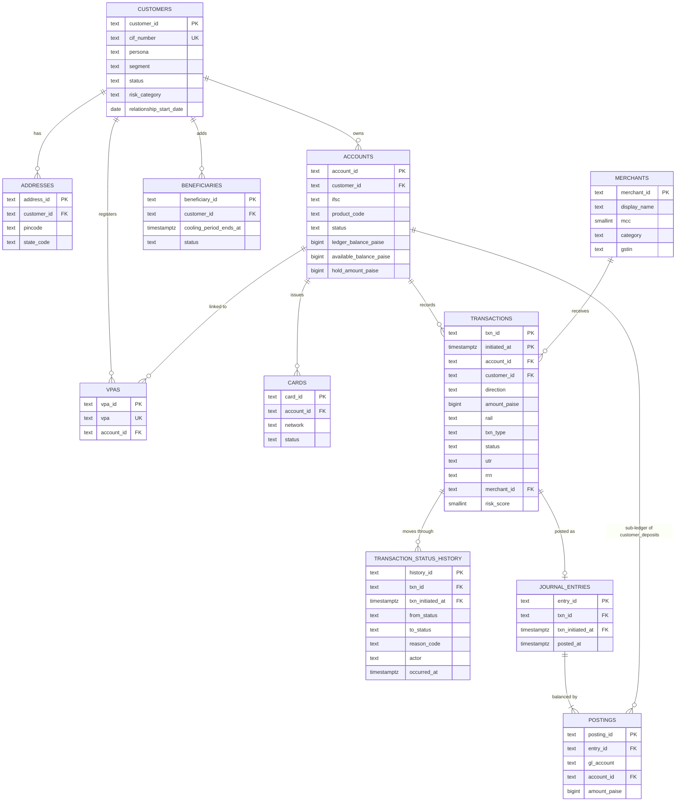

*Notice: `TRANSACTIONS` is partitioned by `initiated_at`, so its key is `(txn_id, initiated_at)` and every table that references it carries `txn_initiated_at` in a composite foreign key ([ADR 0011](../../adr/0011-composite-foreign-keys-to-partitioned-transactions.md)).*

*Notice: balances on `ACCOUNTS` are a cache; `POSTINGS` is the source of truth, and every transaction that moves money has exactly one balanced journal entry. A posting's `gl_account` is `customer_deposits` (and then `account_id` names the customer Account) or an internal GL account such as `upi_settlement`, `fee_income`, `gst_payable` or `suspense`; a CHECK enforces that `account_id` is set exactly for `customer_deposits`. An Account opened before the ledger went live starts with one entry, with no Transaction, against `opening_balances` (its balance brought forward). `available_balance_paise` is a generated column, `ledger_balance_paise − hold_amount_paise`, and the `ledger.account_reconciliation` view compares each cached balance with its Postings.*

## 3. KYC, risk and operations

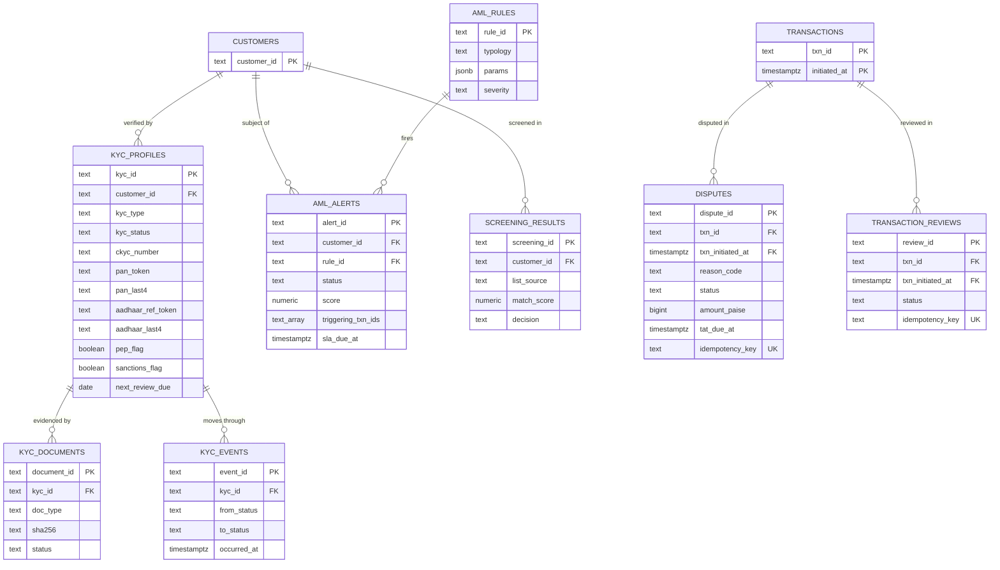

Operational tables with no foreign keys to business data:

| Table | Purpose | Key properties |
|---|---|---|
| `ops.outbox` | Domain events awaiting publication | `published_at IS NULL` partial index |
| `ops.audit_log` | One row per tool call | Append-only: `UPDATE`/`DELETE` revoked from `kosha_app`, and a `kosha.forbid_change()` trigger rejects `UPDATE`, `DELETE` and `TRUNCATE` from anyone, the owner included |
| `ops.idempotency_keys` | Exactly-once effect for writes | PK `(scope, key)`; `expires_at` |

## 4. Knowledge base

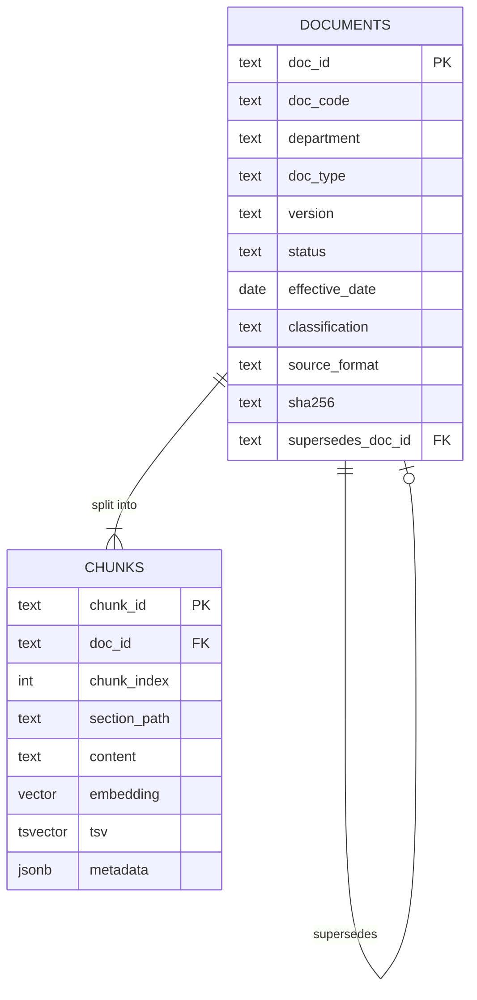

*Notice: `classification` lives on the document but RLS is enforced on chunks through a denormalised copy, so every retrieval path is filtered in the database.*

## 5. Status lifecycles

All lifecycles are encoded once in `kosha-domain` as transition tables, mirrored into `kosha.allowed_transitions` (a parity test compares them edge for edge) and enforced by a `BEFORE UPDATE` trigger on each status column. An illegal transition raises `check_violation` with the trigger's name (`*_lifecycle`) as the constraint and the domain's own wording, and core-api maps it to `conflict`. Inserts are not checked, because historical rows are loaded in their final status together with their history.

### Transaction

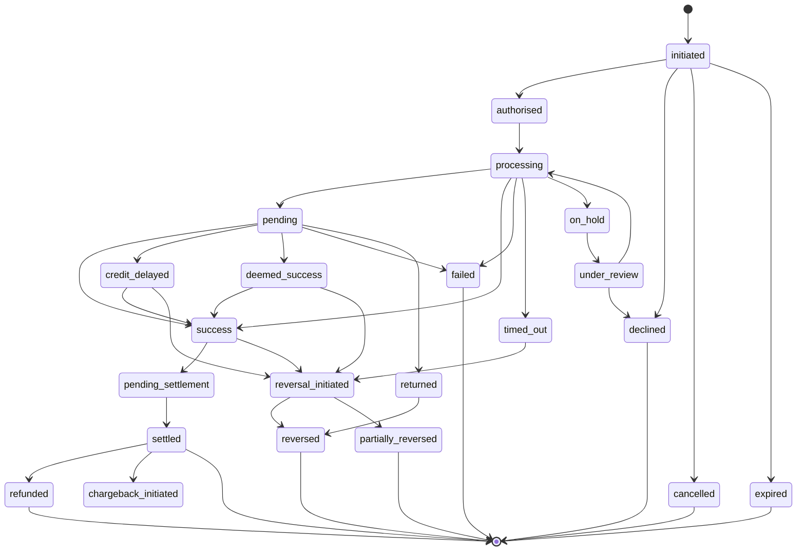

*Notice: `credit_delayed`, `deemed_success` and `timed_out` are the states customers dispute; each has a path to reversal, which drives the RBI TAT compensation logic.*

### Account

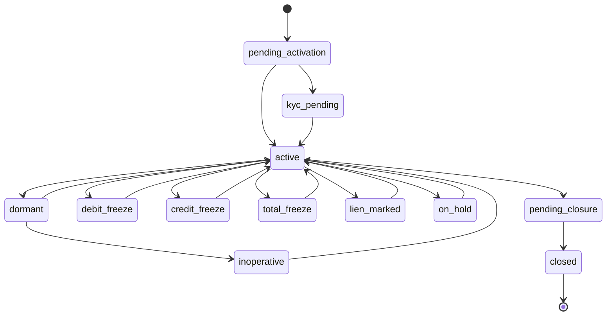

*Notice: `inoperative` (no customer-induced transaction for two years) is reachable only from `dormant`, matching RBI's definition.*

### KYC profile

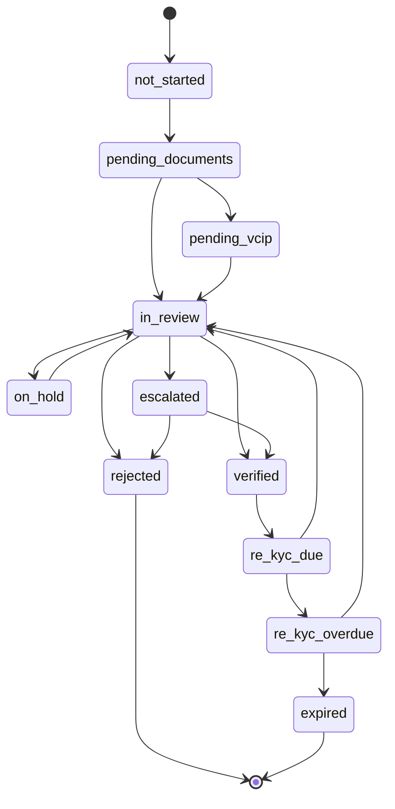

*Notice: `next_review_due` (2, 8 or 10 years by risk category) is what moves `verified` to `re_kyc_due`.*

### Dispute

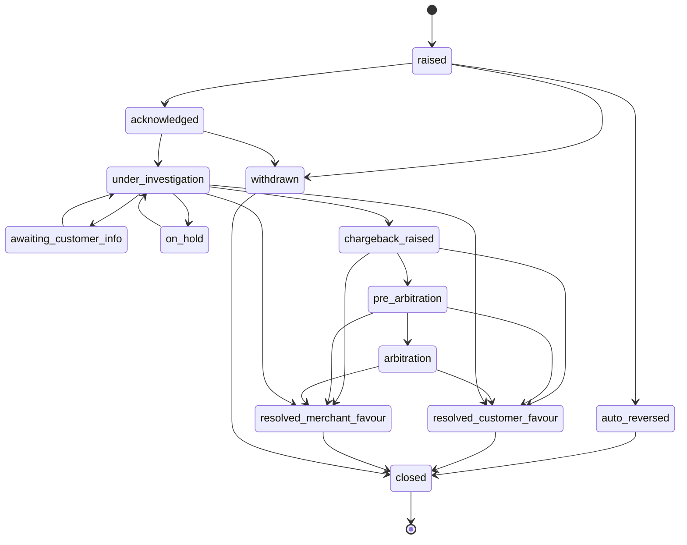

*Notice: `failed_but_debited` disputes on UPI can go straight to `auto_reversed`, mirroring the T+1 auto-reversal rule.*

### AML alert

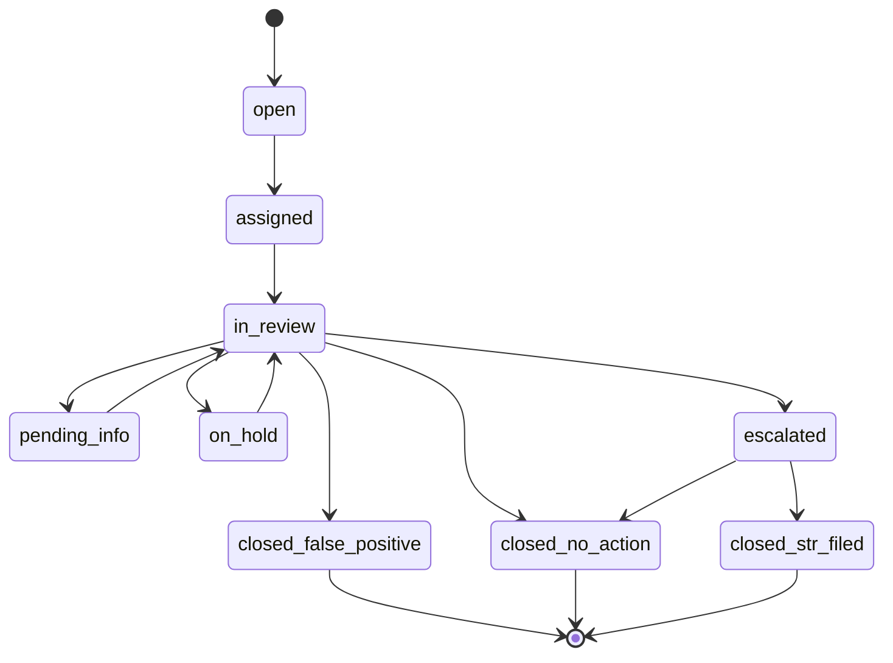

*Notice: only escalated alerts can end in an STR filing, which is what the compliance SOPs require.*

### Card

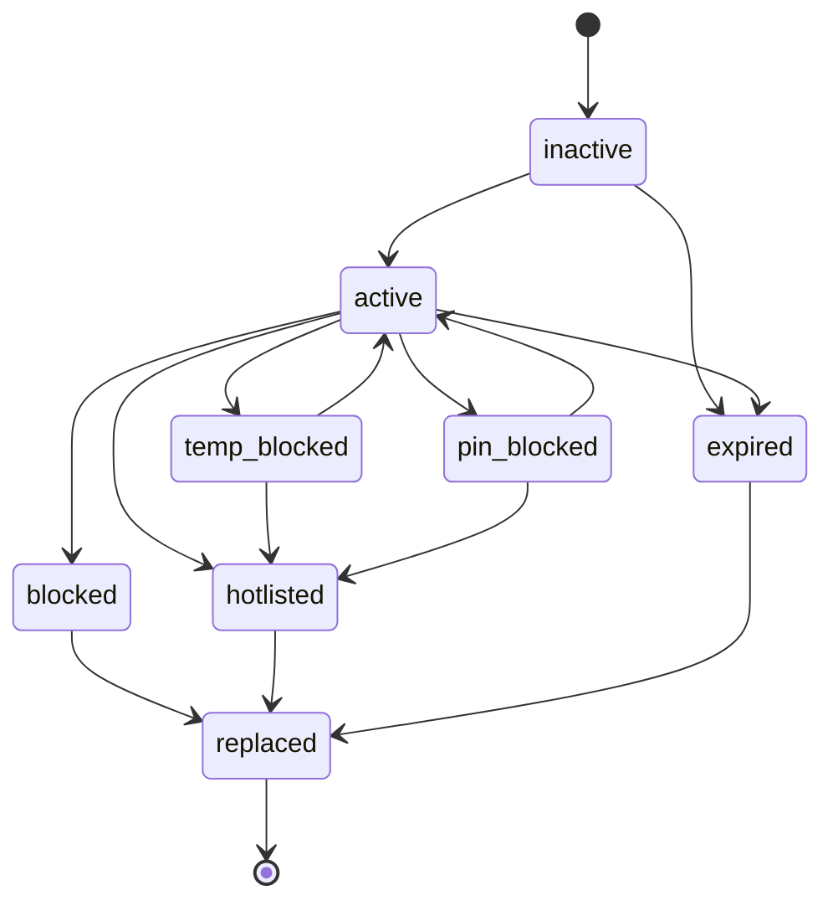

*Notice: `temp_blocked` is the customer's own reversible switch; `hotlisted` (lost or stolen) is permanent and ends only in a replacement card.*

### Transaction review

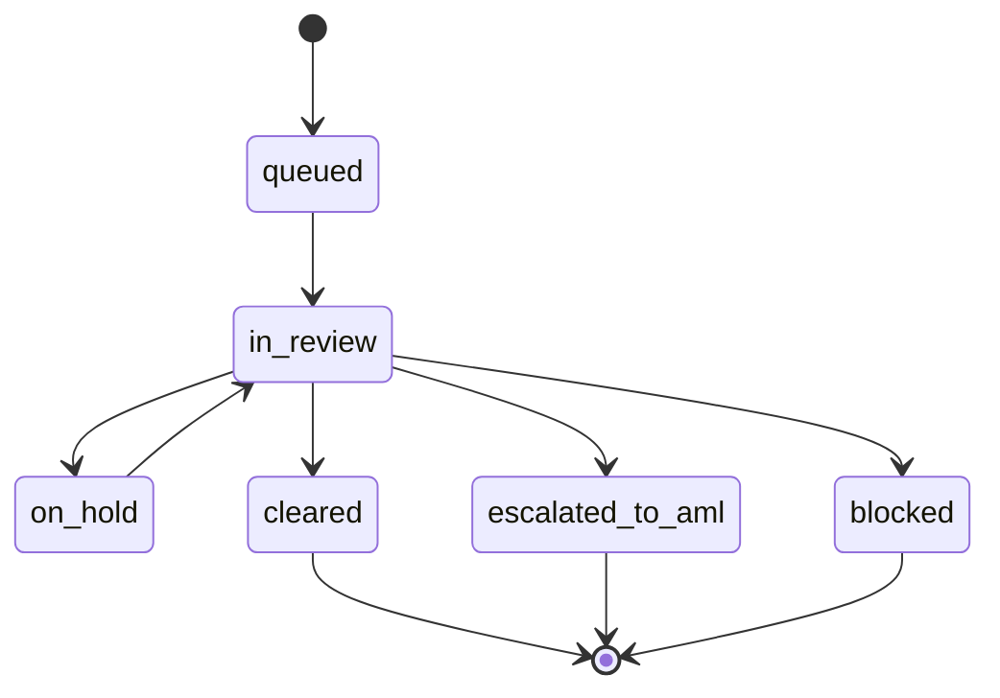

*Notice: a review never closes an AML question itself; it either clears the Transaction or hands it to the AML alert queue.*

### Beneficiary

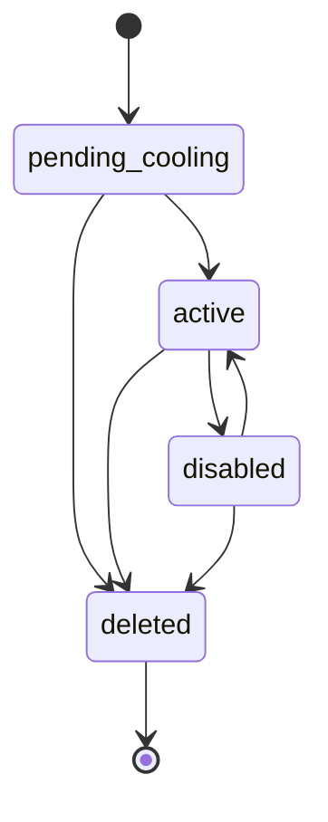

*Notice: a new Beneficiary starts in its Cooling period; transfers to it stay capped until it becomes `active`.*

## 6. Indexes and partitioning

| Table | Index / strategy | Serves |
|---|---|---|
| `core.transactions` | `PARTITION BY RANGE (initiated_at)`, monthly; default partition for out-of-range | Pruning for date-bounded queries |
| `core.transactions` | `(account_id, initiated_at DESC, txn_id DESC)` | `search_transactions` keyset pagination |
| `core.transactions` | `(customer_id, initiated_at DESC)` | Customer-wide views, AML rules |
| `core.transactions` | partial `(merchant_id)`, partial `(utr)` | Merchant drill-down, UTR lookup. UTR is deliberately not unique: a unique index must include the partition key, which would only forbid duplicates at the same instant, and both legs of an on-us transfer share a UTR |
| `core.transactions` | GIN `narration gin_trgm_ops` | Text filter |
| `core.transactions` | partial `(account_id) WHERE status IN ('on_hold','credit_delayed','under_review')` | Ops queues |
| `core.customers` | GIN trigram on `first_name || ' ' || last_name`; unique `cif_number` | `search_customers` |
| `ledger.postings` | `(account_id) INCLUDE (amount_paise)` | Index-only reconciliation of cached balances |
| `risk.aml_alerts` | `(status, sla_due_at)` | Alert queue ordering |
| `ops.outbox` | partial `(created_at) WHERE published_at IS NULL` | Relay polling |
| `kb.chunks` | HNSW `embedding vector_cosine_ops (m = 16, ef_construction = 64)` | Vector half of hybrid search |
| `kb.chunks` | GIN `tsv` | Full-text half of hybrid search |

Partitions are monthly in UTC. `kosha.create_transaction_partitions(first_month, last_month)` creates any that are missing; the first migration covers 18 months back and 3 ahead, and a scheduled job keeps 3 months ahead. A month whose rows already sit in the default partition cannot be split out without moving them first, so the job must run before the month arrives.

## 7. Row-level security for the knowledge base

```sql
CREATE TYPE kb.classification AS ENUM ('public', 'internal', 'confidential', 'restricted');

-- The application sets the caller's ceiling per transaction; default is the lowest level.
CREATE FUNCTION kb.caller_ceiling() RETURNS kb.classification
    LANGUAGE sql STABLE PARALLEL SAFE
    RETURN coalesce(
        nullif(current_setting('kosha.kb_ceiling', true), '')::kb.classification,
        'public'::kb.classification
    );

ALTER TABLE kb.chunks ENABLE ROW LEVEL SECURITY;
ALTER TABLE kb.chunks FORCE ROW LEVEL SECURITY;
CREATE POLICY chunks_within_ceiling ON kb.chunks FOR SELECT TO kosha_app
    USING (classification <= kb.caller_ceiling());

-- kb.documents carries the same policy, so titles and codes of documents above the
-- ceiling are invisible too.
```

```python
async with uow.read_only() as tx:
    await tx.execute("SELECT set_config('kosha.kb_ceiling', %s, true)", [principal.kb_ceiling])
    rows = await kb_repo.hybrid_search(tx, query)
```

| Role | Ceiling |
|---|---|
| `demo_readonly` | `public` |
| `support_agent` | `internal` |
| `analyst` | `confidential` |
| `compliance_officer` | `restricted` |

`set_config(..., true)` scopes the value to the transaction, so a pooled connection cannot leak a ceiling to the next request. `FORCE` applies the policy even to the table owner. An unknown ceiling fails the cast to `kb.classification`, so the query fails closed rather than defaulting. `chunks.classification` is pinned to its document's by a composite foreign key with `ON UPDATE CASCADE`, so reclassifying a document re-filters its chunks.

## 8. PII handling

| Data | Stored as | Who can see it |
|---|---|---|
| Aadhaar number | Never stored. `aadhaar_ref_token` (vault reference) + `aadhaar_last4`; a CHECK rejects a 12-digit token, so a raw number written by mistake fails | Last 4 only, everyone with `kyc:read` |
| PAN | `pan_token`: KMS envelope-encrypted ciphertext + `pan_last4`; a CHECK rejects a PAN-shaped token | Full value decrypted only for `kyc:pii` |
| Mobile, email, DOB | Plain columns, masked at the gateway | Unmasked for `kyc:pii` |
| Account number | Plain column | Never returned unmasked over MCP |
| Device ID, IP address | Plain columns | `aml:read` |
| KYC document images | Not generated; `s3_key` + `sha256` placeholders | Metadata only |

Retention follows the fictional Record Retention Policy (PMLA: five years after relationship end); the generator marks closed relationships accordingly.
