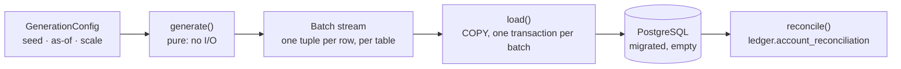
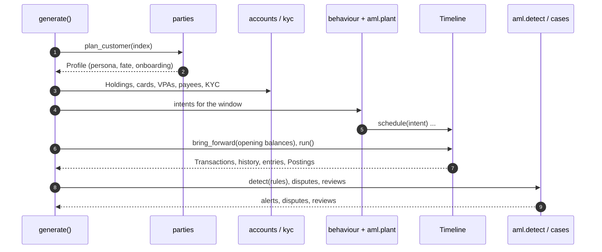

# LLD — `kosha-datagen`

`kosha-datagen` produces Kosha Financial's synthetic dataset: about 5,000 Customers with 18 months of Transactions, a balanced double-entry ledger, KYC, AML alerts, disputes and reviews. It is a library plus a command (`uv run poe seed`); no service imports it at runtime. Volumes and realism rules: [plan v0.2](../../plans/v0.2-data-model-and-corpus.md) §§0–2.

## 1. Shape

*Notice: generation and loading meet only at the `Batch`. The row-stream tests run without a database; the loader tests run the same stream into a real one.*

| Module | Responsibility |
|---|---|
| `config` | `GenerationConfig`, the window (18 months ending on the as-of date), per-stream random sources |
| `catalog` | Curated cities with real pincode ranges, regional names, banks, IFSC codes, UPI handles, fictional employers and merchants |
| `refs` | Reference numbers in their real shapes: CIF, account number, PAN, GSTIN, RRN, NEFT and RTGS UTRs |
| `parties` | `Profile`: a planned Customer with persona, segment and fate, plus their Customer and Address rows |
| `accounts` | `Holding` (an Account whose balance is still moving), cards, VPAs, Beneficiaries |
| `kyc` | KYC profiles, documents and status history; sanctions and PEP screening |
| `behaviour` | What each persona does with money, month by month, as intents |
| `outcomes` | Outcome scenarios: explicit status paths with their economics |
| `payments` | The timeline: executes intents against live balances into Transactions, history and Postings |
| `ledger` | Posting rules per Rail and Transaction type ([core-api LLD §5](core-api.md#5-ledger-posting-algorithm)) |
| `aml` | Rules, planted typologies, detection, alerts |
| `cases` | Disputes and Transaction reviews |
| `loader`, `reconcile` | `COPY` into the database; prove the ledger |

## 2. Determinism

Every value comes from a random stream named by the seed and a purpose (`rng("customer", 42)`, hashed with SHA-512), and identifiers are ULIDs minted from the event's own instant with the same stream. A dataset is therefore fixed by `(seed, as_of, scale)`. Customers are generated in index order from per-Customer streams, so `--scale 0.01` is exactly the first 1% of the full dataset: the tests see the same people a demo does.

Unique numbers (CIF, mobile, account number) come from an affine bijection of the Customer's index rather than from chance, so uniqueness holds at any scale without a lookup.

## 3. One Customer

*Notice: the fate (dormant, closed, frozen, ...) is chosen before onboarding is dated, so the two always agree: a dormant Customer was onboarded long enough ago to go quiet.*

### Fates

| Fate | Share | What the data shows |
|---|---|---|
| active | ≈ 88% | Normal life; ≈ 1% of Accounts carry a lien, debit or credit freeze, or pending closure |
| dormant | 4.5% | No Customer-initiated Transaction for 12+ months; interest still credited |
| inoperative | 1% | Onboarded before the window; no Customer activity in it at all |
| closed | 2.5% | Balance paid out by NEFT on closure; nothing afterwards |
| prospect | 1.5% | Onboarding unfinished: no Transactions, KYC part-way |
| frozen · deceased · on hold | 2% | Total freeze, debit freeze or hold from a recent date; blocked directions stop |

## 4. The timeline

Intents are executed in time order against each Holding's running balance:

1. **Admission.** The Account's standing must allow the direction at that instant. A debit larger than the available balance is usually not attempted at all (people rarely try a payment they know will bounce); when it is, it is `declined` with NPCI `Z9` or ISO `51`. NACH mandates always attempt, so EMI bounces exist.
2. **Outcome.** A scenario is drawn from the Rail's weights (`outcomes.py`). Each is an explicit status path checked against the Transaction lifecycle, and states whether money moves, is held, or comes back.
3. **Timing.** Each step gets a realistic delay (seconds for UPI, NEFT batches, T+1 auto-reversal, settlement next day). Steps that would fall after the as-of date are cut, so open cases (credit delayed, on hold, awaiting settlement) arise only on recent Transactions.
4. **Ledger.** A Transaction that moved money gets exactly one balanced journal entry. Money that comes back is a separate `reversal` or `refund` credit Transaction later on the timeline, because a journal entry belongs to one Transaction.

| Outcome (debits) | Share |
|---|---|
| Success or settled | ≈ 98% |
| Failed or declined | ≈ 1.2% |
| Reversed, refunded, partially reversed | ≈ 0.3% |
| Credit delayed, deemed success, on hold, under review, returned (recent only) | small tails |

Accounts older than the ledger start with a balance brought forward against `opening_balances` ([ADR 0012](../../adr/0012-opening-balances-gl-for-balances-brought-forward.md)). Savings and deposits earn quarterly interest on the balance at quarter end; Accounts in use pay ₹15 + 18% GST SMS charges each quarter, posted as a three-leg entry.

## 5. Financial crime

One Customer in fifty (index ≡ 16 mod 50, so exactly 2%) is planted with a typology, in rotation. The pattern is written as ordinary intents and runs through the same timeline. Alerts are then **detected**, never planted: seven rules run over every Customer's posted Transactions with the thresholds stored in `risk.aml_rules.params`.

| Typology | Planted pattern | Rule |
|---|---|---|
| structuring | 5–8 IMPS credits of ₹45,000–₹49,900 within days, then one RTGS out | ≥ 3 credits of ₹40,000–₹49,999.99 within 10 days |
| rapid movement | ₹3L–₹12L RTGS in, 2–4 IMPS out within 30 hours | credit ≥ ₹1.5L, ≥ 80% out within 72 hours |
| mule account | 10–18 UPI credits from strangers on a new Account, each forwarded within hours | ≥ 8 distinct senders within 10 days, Account ≤ 120 days old |
| round tripping | RTGS out to a counterparty, most of it back from the same name 10–25 days later | ≥ ₹10L out, ≥ 80% back within 30 days |
| dormant reactivation | quiet since before the window, then large credits and outflows | ≥ 300 quiet days, then ≥ ₹1L credited within 30 days |
| high-risk geography | 2–4 card payments in Yangon or Tehran | any card use in a listed city |
| velocity | 15–25 UPI debits within an hour | ≥ 12 UPI debits within 60 minutes |

False positives come from ordinary life the rules cannot tell apart, chiefly a loan disbursal paid straight out as a down payment (≈ 7% of active Customers). Alerts age into dispositions: recent ones are open or in review, older ones closed; a planted actor's alert is escalated and usually ends in an STR, an ordinary Customer's is closed as a false positive.

## 6. Loading

| Concern | Approach |
|---|---|
| Speed | `COPY` per table per batch; StrEnum values adapt as their labels, `dict` columns as `jsonb` |
| Triggers | Off while copying (`SET LOCAL session_replication_role = replica`, as `pg_restore --disable-triggers` does). Per-row foreign-key checks into the partitioned Transactions table and the deferred balance triggers cost about 11× the copy itself (145 s against 13 s for 200 Customers). CHECK constraints and unique indexes are not triggers and still apply. A role without the `SET` privilege loads with triggers on: slower, equally correct |
| Memory | One transaction per 200 Customers, so even a trigger-on load queues ≈ 100k deferred events, not millions |
| Partitions | `kosha.create_transaction_partitions(window start, as-of)` runs first; no row ever lands in the default partition |
| Role | Loads as the table owner: `kosha_app` may not write history or ledger tables in bulk, nor `kb.*` at all |
| Idempotence | Refuses a database that already holds Customers (`AlreadySeededError`); seed a fresh one |
| Exit check | `reconcile()` proves in one set-based pass what the triggers would have checked row by row: every foreign key (read from `pg_constraint`, so none can be forgotten) by anti-join, every journal entry balanced across at least two Postings, every cached balance equal to its Postings (`ledger.account_reconciliation`), and all Postings summing to zero. Any failure fails the command |

## 7. Tests

| Seam | Catches | Misses |
|---|---|---|
| `generate(config)` row streams (≈ 50 tests, no database) | Formats against `kosha-domain` validators, determinism and prefix property, lifecycle paths, balanced entries, cached balance = Σ Postings, no overdraft, distributions, dormancy and closure rules, every typology fires | Schema mismatches |
| `load` + `reconcile` against a migrated pgvector (integration) | Column names, constraints, partitions, the CLI end to end, and that reconciliation catches orphans and unbalanced entries slipped past disabled triggers | Volume effects at full scale (checked by `poe seed`) |
