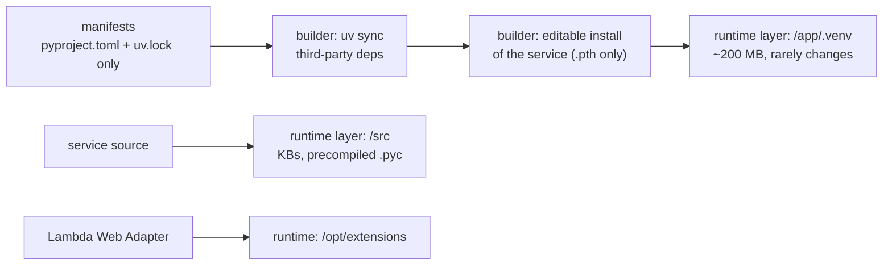
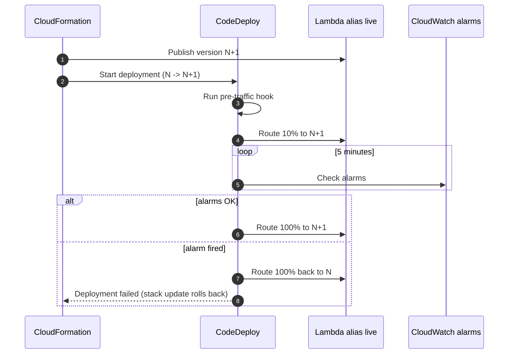

# LLD — Deployment and CI/CD

GitHub Actions is the only pipeline. It authenticates to AWS through OIDC (no stored keys), deploys with AWS CDK (Python), and shifts Lambda traffic with CodeDeploy canaries that roll back automatically on alarms.

## 1. Pipeline

```mermaid
flowchart LR
    pr["Pull request"] --> ci
    subgraph ci["ci.yml (every push and PR)"]
        lint["Lint and format<br/>ruff"]
        types["Type check<br/>pyright strict"]
        unit["Unit + property tests"]
        integ["Integration tests<br/>testcontainers, LocalStack"]
        sec["Security<br/>gitleaks, bandit, pip-audit"]
        build["Build images<br/>buildx, arm64, cache"]
        scan["Trivy scan"]
        docs["Docs build<br/>mkdocs --strict"]
        synth["cdk synth + cdk-nag"]
    end
    ci -->|"merge to main"| cd
    subgraph cd["cd.yml (main)"]
        oidc["Assume deploy role<br/>OIDC"]
        push["Push images to ECR<br/>by digest"]
        deploy["cdk deploy<br/>new Lambda versions"]
        canary["CodeDeploy canary<br/>10% for 5 min"]
        smoke["Smoke + e2e tests<br/>real Cognito tokens"]
        done["100% traffic"]
    end
    oidc --> push --> deploy --> canary --> smoke --> done
    canary -->|"alarm in ALARM"| rollback["Automatic rollback<br/>alias back to previous version"]
    smoke -->|"failure"| rollback
```



*Notice: images are built and scanned once in CI and deployed by digest, so what was tested is exactly what runs.*

| Workflow | Trigger | Purpose |
|---|---|---|
| `ci.yml` | push, pull request | Quality gates; required for merge |
| `cd.yml` | push to `main` (after CI), manual dispatch | Build, push, deploy, canary, e2e |
| `eval.yml` | nightly, manual | RAG evaluation report and badges |
| `load.yml` | manual | Locust against the deployed stack; SLO report |
| `docs.yml` | push to `main` touching `docs/` | Publish MkDocs site to GitHub Pages |
| `release-please.yml` | push to `main` | Changelog and version tags from Conventional Commits |

Deploy steps are guarded by repository variable `AWS_DEPLOY_ENABLED` until the infrastructure phase (P6) lands.

## 2. OIDC trust

```json
{
  "Effect": "Allow",
  "Principal": { "Federated": "arn:aws:iam::<project-account-id>:oidc-provider/token.actions.githubusercontent.com" },
  "Action": "sts:AssumeRoleWithWebIdentity",
  "Condition": {
    "StringEquals": {
      "token.actions.githubusercontent.com:aud": "sts.amazonaws.com",
      "token.actions.githubusercontent.com:sub": "repo:<owner>/ledgerlens-mcp:environment:production"
    }
  }
}
```

| Rule | Reason |
|---|---|
| `sub` pinned to the `production` environment | Only jobs that pass environment protection can deploy |
| Role permissions limited to CDK bootstrap roles (`cdk-*-deploy-role`, `cdk-*-file-publishing-role`, `cdk-*-image-publishing-role`) | CloudFormation does the actual provisioning with its execution role |
| Session duration 1 hour | |

## 3. Environments

| Environment | Where | Data | Purpose |
|---|---|---|---|
| `local` | `docker compose` | Seeded synthetic data | Development, integration tests, Grafana dashboards |
| `ci` | GitHub runners (containers) | Ephemeral, seeded per job | Automated tests |
| `production` | AWS `eu-north-1` | Seeded synthetic data | Public demo endpoint |

One AWS environment keeps cost down; canary + rollback provide the safety a staging stage would otherwise give.

## 4. Container image strategy

One parametrised [`docker/Dockerfile`](https://github.com/sourav-dhar/ledgerlens-mcp/blob/main/docker/Dockerfile) builds every Python deployable (`--build-arg SERVICE=<name>`). Stages:


*Source edits only touch the last, tiny layer: a code-only rebuild takes ~7 s instead of ~155 s.*

The virtualenv layer is reproducible bit for bit: uv's `uv_cache.json` (source timestamps used only for uv's own cache) is removed, so BuildKit's content-addressed cache reuses the layer across code changes.

| Practice | Effect |
|---|---|
| Multi-stage; runtime stage has no `uv`, compilers or source tree | Smaller image, smaller attack surface |
| Dependency layer separated from source layer; venv layer reproducible | Code changes rebuild in ~7 s |
| `--frozen` from `uv.lock` | Reproducible builds; lockfile drift fails the build |
| BuildKit cache mounts + GitHub Actions cache (`type=gha`) | Warm CI builds |
| `linux/arm64` (Graviton) | ~20% cheaper Lambda compute |
| Non-root user (uid 10001); code root-owned and read-only | Process cannot modify itself |
| Lambda Web Adapter as extension | Same image serves HTTP locally and on Lambda; readiness via `/readyz` |
| Base images pinned by tag **and digest**, scanned by Trivy (fails on fixable HIGH/CRITICAL) | Reproducible, known CVE baseline |

Exact base and adapter versions are pinned in the Dockerfile and bumped by Dependabot. Target uncompressed size: < 250 MB per image.

## 5. Lambda versions, aliases and canary

| Element | Configuration |
|---|---|
| Versions | Every deploy publishes a new immutable version |
| Alias | `live`; API Gateway integrates with the alias, never `$LATEST` |
| Deployment config | `LambdaCanary10Percent5Minutes` |
| Rollback alarms | Alias `Errors` > 1% over 1 min, `p95 Duration` > SLO × 1.5, gateway `5xx` rate > 2% |
| Hooks | Pre-traffic hook Lambda calls `/healthz` and one read tool with a client-credentials token |
| Database migrations | Run by a one-off migration task before traffic shift; migrations are backward compatible (expand → migrate → contract across releases) |



*Notice: a bad release only ever reaches 10% of traffic for at most 5 minutes before an alarm returns all traffic to the previous version.*

## 6. Rollback and recovery

| Failure | Recovery |
|---|---|
| Canary alarm | Automatic; alias back to previous version |
| Post-deploy e2e failure | `cd.yml` triggers CodeDeploy stop with rollback |
| Bad migration | Forward-fix only; migrations are additive, so the previous code version still runs |
| Corrupted data in demo | `poe seed --reset` reloads deterministic data |
