# LLD — `mcp-gateway`

The gateway is the only component MCP clients talk to. It owns the protocol, identity, authorization, data minimisation and the resilience policy toward everything downstream. It holds **no domain state**.

## 1. Module structure

```
services/mcp-gateway/src/mcp_gateway/
├── app.py               # build_app(settings) -> ASGI app; FastMCP server + /healthz + RFC 9728 route
├── settings.py          # pydantic-settings; every timeout and limit is explicit
├── auth/
│   ├── provider.py      # FastMCP Cognito / OAuth-proxy provider wiring
│   ├── principal.py     # Principal(sub, client_id, roles, scopes, kb_ceiling)
│   └── scopes.py        # Scope enum, ROLE_SCOPES, require(scope) helper
├── middleware/
│   ├── rate_limit.py    # DynamoDB token bucket -> 429 + Retry-After
│   ├── deadline.py      # request budget, X-Request-Deadline propagation
│   ├── load_shed.py     # in-flight limit, minimum remaining budget
│   ├── chaos.py         # HMAC-verified fault injection (non-prod + operator scope)
│   └── audit.py         # one audit record per tool call, success or failure
├── tools/
│   ├── customers.py     # search_customers, get_customer_profile
│   ├── kyc.py           # get_kyc_status, list_kyc_documents
│   ├── payments.py      # get_account_summary, search_transactions, get_transaction, get_spending_insights
│   ├── risk.py          # list_aml_alerts, get_aml_alert, screen_entity
│   ├── writes.py        # raise_dispute, flag_transaction_for_review
│   ├── knowledge.py     # search_knowledge_base, get_document
│   └── ops.py           # get_service_health
├── resources.py         # kb://{department}/{doc_code}, customer://{customer_id}
├── prompts.py           # investigate_suspicious_activity, kyc_periodic_review, dispute_triage
├── masking.py           # role-aware field masking (pure functions)
├── cursors.py           # HMAC-signed opaque pagination cursors
├── errors.py            # error taxonomy -> MCP tool errors
└── clients/
    ├── core_api.py      # typed httpx client wrapped in kosha_resilience policies
    └── screening.py     # typed httpx client for screening-sim, behind its own breaker
```

Tools are thin: validate input, check scope, call one `clients.*` method, mask, return. Domain logic lives in `core-api`.

## 2. Request pipeline

```mermaid
flowchart LR
    req["HTTP POST /mcp"] --> shed["1 Load shed<br/>in-flight and budget check"]
    shed --> rl["2 Rate limit<br/>token bucket per client_id"]
    rl --> authn["3 Authenticate<br/>JWT signature, iss, aud, exp"]
    authn --> chaos["4 Chaos<br/>verify HMAC, arm faults"]
    chaos --> dl["5 Deadline<br/>start budget, trace span"]
    dl --> authz["6 Authorize<br/>tool scope check"]
    authz --> tool["7 Tool<br/>validate input, call core-api"]
    tool --> mask["8 Mask<br/>per role"]
    mask --> audit["9 Audit<br/>always runs, also on error"]
    audit --> resp["Tool result"]
```



*Notice: rate limiting runs before JWT verification so unauthenticated floods are cheap to reject; audit runs in a `finally` so denied and failed calls are recorded too.*

| Order | Stage | Rejects with | Notes |
|---|---|---|---|
| 1 | Load shed | `503` + `Retry-After` | In-flight > `MAX_IN_FLIGHT` or no usable budget |
| 2 | Rate limit | `429` + `Retry-After` | Keyed by `client_id` from unverified token claim, falling back to source IP; re-keyed after authn |
| 3 | Authenticate | `401` + `WWW-Authenticate` with `resource_metadata` | JWKS cached 10 min, refreshed on unknown `kid` |
| 4 | Chaos | ignored if invalid | Only honoured when `CHAOS_ENABLED` and principal has the operator role |
| 5 | Deadline | — | Budget = `min(client hint, TOOL_BUDGET[tool])` |
| 6 | Authorize | tool error `forbidden` (`403` semantics) | Scope from `TOOL_SCOPES`; KB ceiling from role |
| 7 | Tool | per taxonomy | Pydantic validation errors map to `invalid_argument` |
| 8 | Mask | — | Pure function of (payload, principal) |
| 9 | Audit | — | Write failure is logged and metered, never fails the call |

## 3. Tool contract template

Every tool follows the same shape so it can be tested the same way.

```python
class SearchTransactionsInput(BaseModel):
    model_config = ConfigDict(extra="forbid", frozen=True)

    account_id: AccountId
    from_date: date | None = None
    to_date: date | None = None
    min_amount_paise: PositivePaise | None = None
    max_amount_paise: PositivePaise | None = None
    rails: frozenset[Rail] = frozenset()
    statuses: frozenset[TransactionStatus] = frozenset()
    text: Annotated[str, StringConstraints(max_length=100)] | None = None
    limit: Annotated[int, Field(ge=1, le=100)] = 25
    cursor: SignedCursor | None = None

    @model_validator(mode="after")
    def _ranges(self) -> Self: ...  # from_date <= to_date, min <= max, window <= 366 days


class SearchTransactionsOutput(BaseModel):
    items: list[TransactionView]
    next_cursor: SignedCursor | None
    truncated: bool
    as_of: datetime


@mcp.tool(annotations={"readOnlyHint": True, "openWorldHint": False})
async def search_transactions(
    params: SearchTransactionsInput, ctx: Context
) -> SearchTransactionsOutput:
    principal = require(ctx, Scope.TRANSACTIONS_READ)
    page = await core_api(ctx).search_transactions(params)
    return mask(page, principal)
```

| Rule | Reason |
|---|---|
| `extra="forbid"` on inputs | Unknown arguments are rejected, not ignored |
| Money in paise (`int`) with a display string alongside | No floats anywhere on the wire |
| Output models are explicit | FastMCP publishes them as `outputSchema`; contract tests snapshot them |
| Write tools take `idempotency_key: UUID` | Required, not optional |
| Write tools carry `destructiveHint: False, idempotentHint: True` | Accurate hints help clients decide when to confirm |
| Write tools request confirmation via MCP elicitation when the client supports it | Falls back to an explicit `confirm: true` argument |

## 4. Error taxonomy

Tool failures are returned as MCP tool results with `isError: true` and a structured body, so the model can reason about them. Protocol-level failures use HTTP status codes.

| Code | Raised when | HTTP / MCP | Retry hint to client |
|---|---|---|---|
| `unauthenticated` | Missing, expired, malformed token; wrong `aud` or `iss` | HTTP 401 + `WWW-Authenticate` | Re-authenticate |
| `forbidden` | Scope missing; KB ceiling exceeded | Tool error | No |
| `invalid_argument` | Pydantic validation failed; tampered cursor | Tool error | No (fix input) |
| `not_found` | Entity absent or not visible to caller | Tool error | No |
| `conflict` | Idempotency key reused with different payload; illegal state transition | Tool error | No |
| `rate_limited` | Token bucket empty | HTTP 429 + `Retry-After` | Yes, after delay |
| `overloaded` | Load shed | HTTP 503 + `Retry-After` | Yes, after delay |
| `deadline_exceeded` | Budget exhausted | Tool error | Yes, once |
| `dependency_unavailable` | Breaker open or downstream 5xx after retries | Tool error with `dependency` field | Yes, after delay |
| `degraded` | Not an error: result flagged `degraded: true` | Success | n/a |
| `internal` | Anything unexpected | Tool error, generic message, `trace_id` only | Yes, once |

Error bodies never contain stack traces, SQL, or upstream payloads. They always contain `code`, `message`, `trace_id`, and optionally `retry_after_s` and `dependency`.

## 5. Pagination cursors

Cursors are opaque to clients and tamper-evident.

| Field | Content |
|---|---|
| `v` | Format version |
| `k` | Keyset position, e.g. `(initiated_at, txn_id)` of last row |
| `q` | SHA-256 of the canonical query (filters) the cursor belongs to |
| `sub` | Subject the cursor was issued to |
| `exp` | Expiry (15 minutes) |
| `sig` | HMAC-SHA256 over the above with a key from Secrets Manager |

Encoding: `base64url(json(payload)) + "." + base64url(sig)`. Verification failures, a different query hash, a different subject, or expiry all produce `invalid_argument`. Keyset pagination keeps deep pages as fast as the first.

## 6. Tool scopes

| Tool | Required scope | Reads PII | Notes |
|---|---|---|---|
| `search_customers` | `customers:read` | masked | Name / CIF / mobile-last-4 search |
| `get_customer_profile` | `customers:read` | masked unless `kyc:pii` | |
| `get_kyc_status` | `kyc:read` | masked unless `kyc:pii` | PAN last 4 always; full PAN only with `kyc:pii` |
| `list_kyc_documents` | `kyc:read` | no | Metadata only, never document bytes |
| `get_account_summary` | `transactions:read` | no | |
| `search_transactions` | `transactions:read` | counterparty masked | Signed cursor |
| `get_transaction` | `transactions:read` | counterparty masked | Includes status history |
| `get_spending_insights` | `transactions:read` | no | Aggregates only |
| `list_aml_alerts` | `aml:read` | masked | |
| `get_aml_alert` | `aml:read` | masked | Includes triggering transactions |
| `screen_entity` | `screening:run` | n/a | Behind vendor breaker; `status: deferred` when open |
| `raise_dispute` | `disputes:write` | n/a | Idempotent, audited, emits outbox event |
| `flag_transaction_for_review` | `reviews:write` | n/a | Idempotent, audited, emits outbox event |
| `search_knowledge_base` | `kb:read` | n/a | Results limited by role ceiling via RLS |
| `get_document` | `kb:read` | n/a | Same ceiling |
| `get_service_health` | `customers:read` | n/a | Breaker states, dependency latency |

## 7. Masking rules

| Field | Masked form | Unmasked with |
|---|---|---|
| PAN | `******234X` (last 4 kept) | `kyc:pii` |
| Aadhaar | always `XXXX XXXX 1234` | never (only last 4 is stored) |
| Mobile | `******7890` | `kyc:pii` |
| Email | `r****@example.com` | `kyc:pii` |
| Account number | `XXXXXX4321` | never via MCP |
| Counterparty VPA | `ra***@okaxis` | `aml:read` |
| Date of birth | year only | `kyc:pii` |

Masking is a pure function tested exhaustively with property tests: for every role and every view model, no field outside the role's allowance survives.
