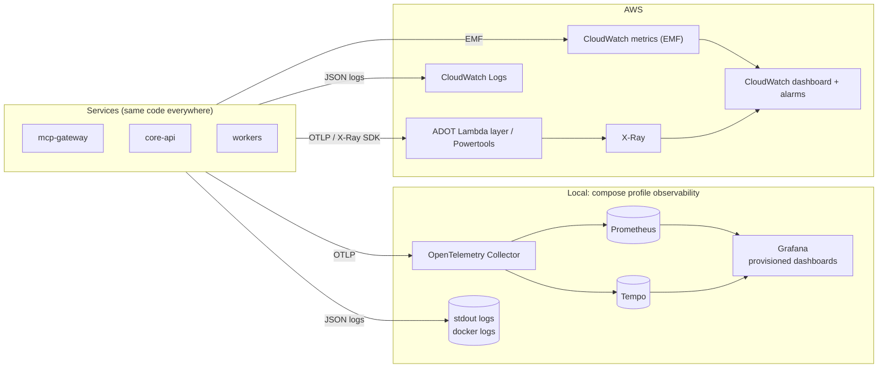

# LLD — Observability

Instrumentation is written once with OpenTelemetry and shipped to two backends: a local Grafana stack in `docker compose`, and CloudWatch + X-Ray in AWS. Shared setup lives in `packages/kosha-observability`.

## 1. Signal flow



*Notice: services only know OpenTelemetry and structured logging; which backend receives the data is deployment configuration.*

## 2. Metrics

RED metrics per tool and per downstream, plus resilience and business signals.

| Metric | Type | Dimensions |
|---|---|---|
| `mcp_tool_requests_total` | counter | `tool`, `outcome` (`ok`, error code) |
| `mcp_tool_duration_ms` | histogram | `tool` |
| `downstream_requests_total` | counter | `dependency`, `outcome` |
| `downstream_duration_ms` | histogram | `dependency` |
| `breaker_state` | gauge | `dependency` (0 closed, 1 half-open, 2 open, 3 forced) |
| `retries_total`, `retry_budget_exhausted_total` | counter | `dependency` |
| `rate_limited_total` | counter | `client_id` (hashed) |
| `load_shed_total` | counter | `reason` |
| `kb_search_degraded_total` | counter | `reason` |
| `db_pool_wait_ms` | histogram | |
| `outbox_lag_seconds` | gauge | age of oldest unpublished event |
| `audit_write_failures_total` | counter | |
| `pii_unmasked_total` | counter | `tool`, `role` |

In AWS these are emitted as Embedded Metric Format through Powertools, which avoids synchronous `PutMetricData` calls. High-cardinality values (customer IDs, trace IDs) are never metric dimensions.

## 3. Log schema

One JSON object per line.

```json
{
  "timestamp": "2026-11-12T09:14:03.512Z",
  "level": "INFO",
  "service": "mcp-gateway",
  "version": "1.4.0+sha.3f9c2e1",
  "message": "tool call completed",
  "trace_id": "4bf92f3577b34da6a3ce929d0e0e4736",
  "span_id": "00f067aa0ba902b7",
  "request_id": "c6af9ac6-7b61-11e6-9a41-93e8deadbeef",
  "cold_start": false,
  "tool": "search_transactions",
  "client_id": "7f3k...",
  "outcome": "ok",
  "duration_ms": 142,
  "breaker": {"core-api": "closed"}
}
```

| Rule | Detail |
|---|---|
| No PII | A logging filter drops or masks fields named like PAN, Aadhaar, mobile, email, account number; tests assert it |
| No raw tool arguments | Only `args_hash`, as in the audit log |
| Correlation | `trace_id` in every line and in every error returned to clients |
| Sampling | DEBUG logs sampled at 1% in production (Powertools log sampling) |

## 4. Trace propagation

| Hop | Propagation |
|---|---|
| Agent → gateway | W3C `traceparent` if the client sends one; otherwise the gateway starts the trace |
| Gateway → `core-api` / `screening-sim` | `traceparent` via httpx instrumentation |
| `core-api` → Postgres | psycopg instrumentation; SQL text without parameters |
| `core-api` → OpenAI | httpx instrumentation; token counts as span attributes |
| Outbox → SQS → worker | `trace_id` in the event envelope, restored as a span link in the worker |
| LangGraph agent | Langfuse traces carry the same `trace_id` as a tag, joining agent reasoning with server spans |

## 5. Dashboards

| Dashboard | Panels |
|---|---|
| Service overview | Requests, error rate, p50/p95/p99 latency per tool; cold starts |
| Resilience | Breaker state timeline per dependency, retries, retry-budget exhaustion, load shedding, rate limiting, degraded searches |
| Data and async | DB pool wait, statement timeouts, outbox lag, queue depth, DLQ depth, ingestion throughput |
| Security | Auth failures by reason, forbidden by tool, PII unmask count by role, chaos header attempts |
| SLOs | Availability and latency SLO burn rate (1 h and 6 h windows) |

Grafana dashboards are provisioned from JSON in `docker/observability/grafana/`; the CloudWatch dashboard is defined in CDK. Both are screenshotted for the docs site.

## 6. Alarms

| Alarm | Condition | Action |
|---|---|---|
| Gateway error rate | 5xx + tool `internal` > 2% for 5 min | Notify; also a CodeDeploy rollback alarm |
| Latency SLO burn | p95 > SLO for 3 of 5 min | Notify; rollback alarm during canary |
| Breaker open | `breaker_state` ≥ 2 for 5 min | Notify |
| DLQ not empty | `ApproximateNumberOfMessagesVisible` > 0 | Notify |
| Outbox lag | `outbox_lag_seconds` > 120 | Notify |
| Audit write failures | > 0 in 5 min | Notify |
| Rate limiter fail-open | DynamoDB errors > 0 in 5 min | Notify |
| RDS | CPU > 80%, free storage < 2 GB, connections > 80% of max | Notify |
| Cost guard | AWS Budgets at 80% of monthly budget | Email |

Notifications go to an SNS topic with an email subscription.
