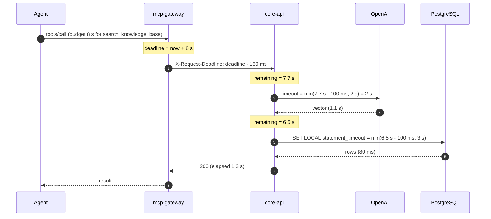
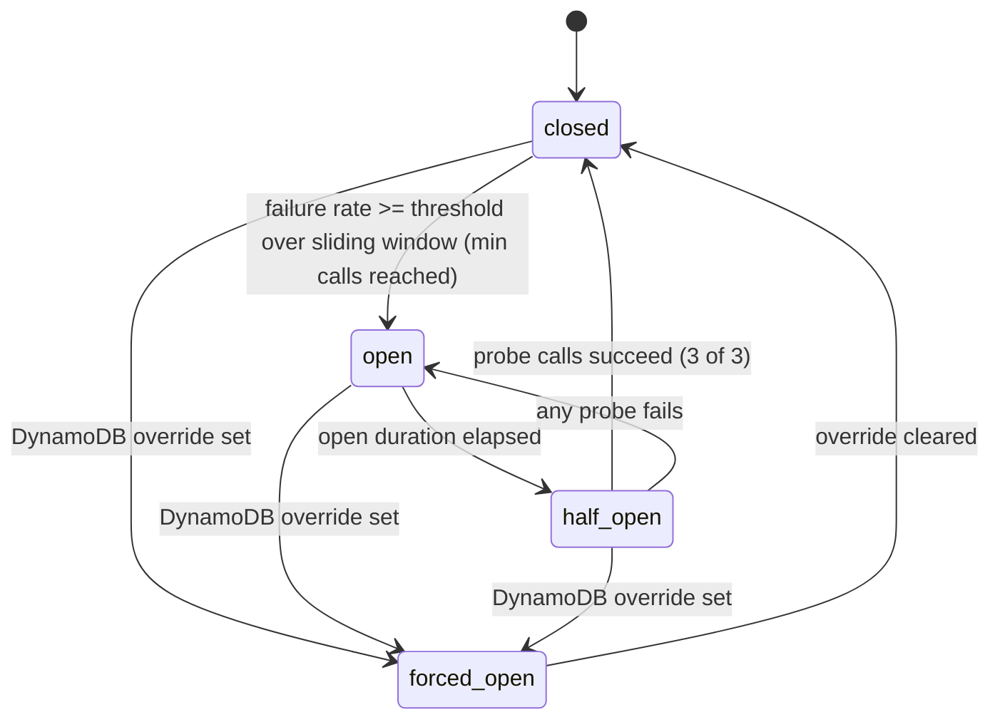

# LLD — Resilience

Implemented in `packages/kosha-resilience` as small, typed, async-first primitives with no framework dependencies. The gateway composes them per downstream; `core-api` uses the same primitives toward OpenAI and Postgres.

## 1. Policy composition

Outer to inner, per downstream call:

```
deadline → bulkhead → circuit breaker → retry (with budget) → timeout → call
```

| Layer | Fails fast with | Why this position |
|---|---|---|
| Deadline | `DeadlineExceeded` | Nothing starts if the request budget is already spent |
| Bulkhead | `BulkheadFull` | Caps concurrent calls per dependency before any work queues up |
| Circuit breaker | `CircuitOpen` | Retries happen inside the breaker, so one logical call counts once toward the failure rate |
| Retry | last error | Only for idempotent operations; each attempt gets a fresh per-attempt timeout bounded by the deadline |
| Timeout | `AttemptTimeout` | Per-attempt cap = `min(remaining_budget - margin, attempt_cap)` |

Per-dependency defaults (all overridable in settings):

| Dependency | Attempt cap | Max attempts | Bulkhead | Breaker window / threshold | Open duration |
|---|---|---|---|---|---|
| `core-api` (reads) | 2.0 s | 3 | 32 | 20 calls / 50% | 15 s |
| `core-api` (writes) | 4.0 s | 1 (idempotency key makes client retry safe) | 16 | 20 calls / 50% | 15 s |
| `screening-sim` | 1.5 s | 2 | 8 | 10 calls / 50% | 30 s |
| OpenAI embeddings | 2.0 s | 2 | 8 | 10 calls / 50% | 30 s |
| PostgreSQL | statement timeout 3 s, pool wait 0.5 s | 1 | pool max 2 | n/a | n/a |

## 2. Deadline propagation



*Notice: each hop subtracts a safety margin, so the caller always gets a well-formed error before its own timeout fires.*

The deadline is an absolute UTC timestamp (not a duration), so clock time spent in queues and network counts against it. Margins absorb serialisation and network time.

## 3. Retry with full jitter and a budget

Delay before attempt `n` (n ≥ 1):

```
delay_n = random_uniform(0, min(cap, base * 2^n))
base = 100 ms, cap = 2 s
```

Full jitter (AWS Architecture Blog, "Exponential Backoff and Jitter") spreads retries evenly and avoids synchronised retry storms.

| Rule | Detail |
|---|---|
| Retryable | Connect errors, timeouts, `502`/`503`/`504`, `429` honouring `Retry-After` |
| Never retried | `4xx` other than `429`; any non-idempotent call without an idempotency key |
| Retry budget | Token bucket per dependency: each success deposits 0.1 token, each retry withdraws 1. Empty budget means no retry; retries can add at most ~10% load |
| Deadline aware | A retry is skipped if `delay + attempt_cap` would exceed the remaining budget |

## 4. Circuit breaker



*Notice: `forced_open` is the fleet-wide escape hatch; normal transitions are per Lambda instance and need no network call.*

| Aspect | Design |
|---|---|
| Window | Count-based sliding window of the last N outcomes |
| Counted as failure | Timeouts, connection errors, `5xx`; not `4xx` |
| Half-open | Admits a limited number of probe calls (3); other calls fail fast |
| State scope | In memory, per Lambda execution environment |
| Override | Item `breaker#<dependency>` in DynamoDB, read at most every 5 s (cached) |
| Observability | State changes emit a log event and a `breaker_state` gauge (0 closed, 1 half-open, 2 open, 3 forced) |

Trade-off: with N warm instances, each instance discovers an outage on its own (up to N × min-calls failures). This is acceptable at demo scale and is recorded in an ADR; the override covers incidents an operator already knows about.

## 5. Bulkhead

`asyncio.Semaphore` per dependency with a non-blocking acquire (`acquire` with a timeout of 0–50 ms). A full bulkhead fails fast with `overloaded` instead of queueing. Lambda reserved concurrency is the outer bulkhead: `core-api` reserved concurrency × pool max (2) stays below `max_connections` on `db.t4g.micro`.

## 6. Rate limiting (token bucket in DynamoDB)

One item per client: `pk = "rl#<client_id>"`, attributes `tokens` (number) and `updated_at` (epoch ms). Capacity 20, refill 1 token/second (60/min).

```python
# Pseudocode: optimistic refill-and-take with a conditional write
item = get(pk) or {"tokens": CAPACITY, "updated_at": now}
refilled = min(CAPACITY, item.tokens + (now - item.updated_at) / 1000 * RATE)
if refilled < 1:
    raise RateLimited(retry_after=(1 - refilled) / RATE)
update(
    pk,
    SET tokens = :new, updated_at = :now,
    ConditionExpression = "attribute_not_exists(pk) OR updated_at = :seen",
    values = {":new": refilled - 1, ":now": now, ":seen": item.updated_at},
)
# ConditionalCheckFailed -> re-read and retry (max 3), then allow (fail-open)
```

| Decision | Choice |
|---|---|
| Consistency | Conditional write on `updated_at` gives compare-and-set without transactions |
| Contention | Max 3 CAS retries per request |
| DynamoDB unavailable | **Fail open** with a metric and alarm; availability over strict fairness |
| Item expiry | TTL attribute 1 hour after last use |

## 7. Load shedding

| Signal | Threshold | Response |
|---|---|---|
| In-flight requests per instance | > `MAX_IN_FLIGHT` (default 64) | `503` + `Retry-After: 1` |
| Remaining budget at tool start | < tool's minimum (e.g. 300 ms) | `deadline_exceeded` without calling downstream |
| Breaker open for the tool's only dependency | open | `dependency_unavailable` immediately |

## 8. Degradation matrix

| Dependency down | Affected tools | Behaviour | Signal to client |
|---|---|---|---|
| OpenAI | `search_knowledge_base` | Full-text-only ranking | `degraded: true`, `degraded_reason: "embeddings_unavailable"` |
| `screening-sim` | `screen_entity` | No synchronous result; request recorded for later | `status: "deferred"`, `retry_after_s` |
| DynamoDB | all | Rate limiting fails open; breaker overrides ignored | Metric + alarm only |
| SQS | `raise_dispute`, `flag_transaction_for_review` | Unaffected: events stay in `ops.outbox` until SQS recovers | none |
| PostgreSQL | all data tools | `dependency_unavailable` after breaker opens | Error with `retry_after_s` |
| `core-api` | all data tools | Breaker opens; `get_service_health` still answers from gateway state | Error with `dependency: "core-api"` |
| Cognito JWKS | all | Cached keys used until expiry (10 min + grace) | none while cache valid |

## 9. Chaos header

Fault injection for demos and resilience tests. Disabled unless `CHAOS_ENABLED=true`, and only honoured for principals with the operator role.

```
X-Kosha-Chaos: v1;target=screening-sim;fault=latency;ms=2500;p=0.5;exp=1767225600;sig=<base64url>
```

| Field | Meaning |
|---|---|
| `target` | `core-api`, `screening-sim`, `openai`, `postgres` |
| `fault` | `latency`, `error` (returns 503), `timeout` (hang past attempt cap), `reset` (connection error) |
| `ms` | Added latency for `latency` |
| `p` | Probability per call, 0–1 |
| `exp` | Unix expiry; max 15 minutes ahead |
| `sig` | HMAC-SHA256 over the header without `sig`, key from Secrets Manager |

Invalid signature, expired header, or missing operator role: the header is ignored and an audit record notes the attempt. `screening-sim` additionally exposes its own knobs (`/admin/chaos`) for scenarios that must not depend on the gateway.
