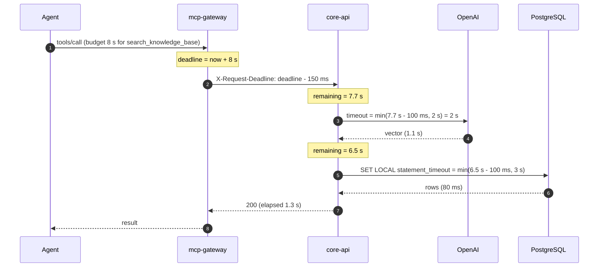
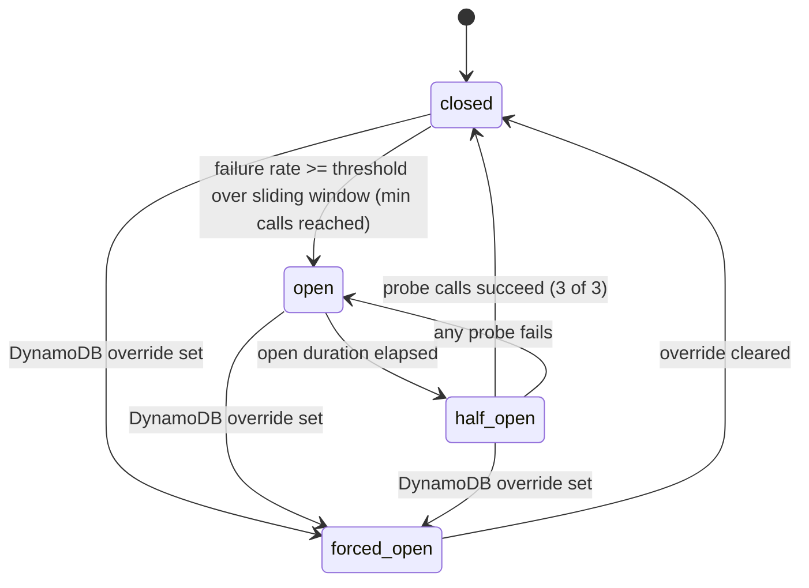
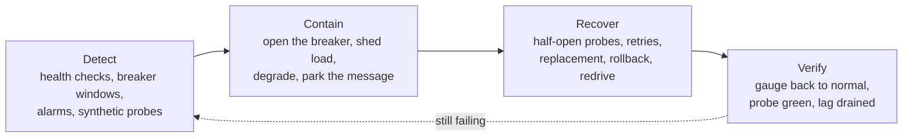

# LLD — Resilience

Implemented in `packages/kosha-resilience` as small, typed, async-first primitives with no framework dependencies. The gateway composes them per downstream; `core-api` uses the same primitives toward OpenAI and Postgres.

## 1. Policy composition

Outer to inner, per downstream call:

```
deadline → bulkhead → circuit breaker → retry (with budget) → timeout → call
```

| Layer | Fails fast with | Why this position |
|---|---|---|
| Deadline | `DeadlineExceeded` | Nothing starts if the request budget is already spent |
| Bulkhead | `BulkheadFull` | Caps concurrent calls per dependency before any work queues up |
| Circuit breaker | `CircuitOpen` | Retries happen inside the breaker, so one logical call counts once toward the failure rate |
| Retry | last error | Only for idempotent operations; each attempt gets a fresh per-attempt timeout bounded by the deadline |
| Timeout | `AttemptTimeout` | Per-attempt cap = `min(remaining_budget - margin, attempt_cap)` |

Per-dependency defaults (all overridable in settings):

| Dependency | Attempt cap | Max attempts | Bulkhead | Breaker window / threshold | Open duration |
|---|---|---|---|---|---|
| `core-api` (reads) | 2.0 s | 3 | 32 | 20 calls / 50% | 15 s |
| `core-api` (writes) | 4.0 s | 2, same `Idempotency-Key` (a retry after a lost response replays the stored one) | 16 | 20 calls / 50% | 15 s |
| `screening-sim` | 1.5 s | 2 | 8 | 10 calls / 50% | 30 s |
| OpenAI embeddings | 2.0 s | 2 | 8 | 10 calls / 50% | 30 s |
| PostgreSQL | statement timeout 3 s, pool wait 0.5 s | 1 | pool max 2 | n/a | n/a |

## 2. Deadline propagation



*Notice: each hop subtracts a safety margin, so the caller always gets a well-formed error before its own timeout fires.*

The deadline is an absolute UTC timestamp (not a duration), so clock time spent in queues and network counts against it. Margins absorb serialisation and network time.

## 3. Retry with full jitter and a budget

Delay before attempt `n` (n ≥ 1):

```
delay_n = random_uniform(0, min(cap, base * 2^n))
base = 100 ms, cap = 2 s
```

Full jitter (AWS Architecture Blog, "Exponential Backoff and Jitter") spreads retries evenly and avoids synchronised retry storms.

| Rule | Detail |
|---|---|
| Retryable | Connect errors, timeouts, `502`/`503`/`504`, `429` honouring `Retry-After` |
| Never retried | `4xx` other than `429`; any write without an idempotency key. A write is retried only with its original key, never a new one |
| Retry budget | Token bucket per dependency: each success deposits 0.1 token, each retry withdraws 1. Empty budget means no retry; retries can add at most ~10% load |
| Deadline aware | A retry is skipped if `delay + attempt_cap` would exceed the remaining budget |

## 4. Circuit breaker



*Notice: `forced_open` is the fleet-wide escape hatch; normal transitions are per Lambda instance and need no network call.*

| Aspect | Design |
|---|---|
| Window | Count-based sliding window of the last N outcomes |
| Counted as failure | Timeouts, connection errors, `5xx`; not `4xx` |
| Half-open | Admits a limited number of probe calls (3); other calls fail fast |
| State scope | In memory, per Lambda execution environment |
| Override | Item `breaker#<dependency>` in DynamoDB, read at most every 5 s (cached) |
| Observability | State changes emit a log event and a `breaker_state` gauge (0 closed, 1 half-open, 2 open, 3 forced) |

Trade-off: with N warm instances, each instance discovers an outage on its own (up to N × min-calls failures). This is acceptable at demo scale and is recorded in an ADR; the override covers incidents an operator already knows about.

## 5. Bulkhead

`asyncio.Semaphore` per dependency with a non-blocking acquire (`acquire` with a timeout of 0–50 ms). A full bulkhead fails fast with `overloaded` instead of queueing. Lambda reserved concurrency is the outer bulkhead: `core-api` reserved concurrency × pool max (2) stays below `max_connections` on `db.t4g.micro`.

## 6. Rate limiting, in layers

Each layer stops a different kind of excess, so no single one has to be perfect ([ADR 0015](../../adr/0015-layered-rate-limits-weighted-and-fail-soft.md)). Outside in:

| # | Layer | Where | Keyed on | Limit (defaults) | When exceeded | Phase |
|---|---|---|---|---|---|---|
| 1 | Flood guard | API Gateway HTTP API stage and route throttling | Aggregate | 50 req/s steady, burst 100 | `429` from API Gateway, before any Lambda runs | P6 |
| 2 | Per-IP guard (optional) | AWS WAF rate-based rule on CloudFront (`us-east-1`) | Source IP | 300 req per 5 min | `429` at the edge | P6, if the plan's service list allows it |
| 3 | Fair share per principal | Gateway, **after** JWT validation | `(client_id, sub)` | 60 tokens/min, burst 20 | `429` + `Retry-After` | P3 |
| 4 | Ceiling per client | Gateway, same request | `client_id` | 300 tokens/min, burst 100 | `429` + `Retry-After` | P3 |
| 5 | Cost weights | Gateway | Tool | Tokens per call, below | Fewer calls per minute for costly tools | P3 |
| 6 | Outbound quotas | Client side, per downstream | Dependency | OpenAI: the account's RPM/TPM and a daily spend cap; `screening-sim`: 5 req/s | Degrade (`full_text`, `deferred`); never queue | P4–P5 |
| 7 | Concurrency ceilings | Lambda reserved concurrency; SQS event-source maximum concurrency | Function | Gateway 20; `core-api` 10; each worker 2 | Throttled invocations; SQS keeps the backlog | P6 |
| 8 | Connection budget | `core-api` pool, `statement_timeout` | Instance | 2 connections; 3 s per statement | `503` / `504` (built in P2) | ✅ |

Layer 3 is keyed on the verified identity, never on a claim the gateway has not checked, so a forged token cannot drain someone else's bucket; layers 1 and 2 absorb anonymous floods before authentication costs anything. Layer 4 stops a runaway fleet of agents that share one OAuth client from starving everyone else.

**Tool weights** (tokens taken per call):

| Weight | Tools | Why |
|---|---|---|
| 1 | `get_customer_profile`, `get_kyc_status`, `list_kyc_documents`, `get_account_summary`, `get_transaction`, `get_aml_alert`, `get_document`, `get_service_health` | One indexed lookup |
| 2 | `search_customers`, `search_transactions`, `get_spending_insights`, `list_aml_alerts` | Scans a range or aggregates |
| 3 | `search_knowledge_base`, `screen_entity` | Paid or rate-limited downstream (OpenAI, the screening vendor) |
| 5 | `raise_dispute`, `flag_transaction_for_review` | Writes: a confused agent should hit the wall after a dozen, not a thousand |

**Algorithm:** a token bucket per key in DynamoDB, one item each: `pk = "rl#p#<client_id>#<sub>"` or `"rl#c#<client_id>"`, attributes `tokens`, `updated_at` (epoch ms) and a TTL one hour after last use. Both buckets are updated in parallel; the request proceeds only if both had enough tokens.

```python
# Pseudocode: optimistic refill-and-take with a conditional write, per bucket
item = get(pk) or {"tokens": capacity, "updated_at": now}
refilled = min(capacity, item.tokens + (now - item.updated_at) / 1000 * rate)
if refilled < weight:
    raise RateLimited(retry_after=(weight - refilled) / rate)
update(
    pk,
    SET tokens = :new, updated_at = :now, expires_at = :ttl,
    ConditionExpression = "attribute_not_exists(pk) OR updated_at = :seen",
    values = {":new": refilled - weight, ":now": now, ":seen": item.updated_at},
)
# ConditionalCheckFailed -> re-read and retry (max 3)
```

| Decision | Choice |
|---|---|
| Consistency | Conditional write on `updated_at`: compare-and-set without transactions |
| Contention | Max 3 compare-and-set retries; per-principal keys are rarely hot |
| Response | HTTP `429` before MCP dispatch, with `Retry-After` and the IETF `RateLimit-Policy` / `RateLimit` fields; the JSON body carries `retry_after_s` for agents that read only the payload |
| **DynamoDB unavailable** | **Fail soft**, not open: each instance falls back to an in-memory bucket with the same parameters. With reserved concurrency 20, the worst case is 20× the limit for the duration of the outage, bounded and metered, instead of unlimited. A metric and an alarm fire |
| Clock | Lambda clocks are NTP-synchronised; the bucket tolerates small skew because refill is clamped to capacity |

## 7. Load shedding

| Signal | Threshold | Response |
|---|---|---|
| In-flight requests per instance | > `MAX_IN_FLIGHT` (default 64) | `503` + `Retry-After: 1` |
| Remaining budget at tool start | < tool's minimum (e.g. 300 ms) | `deadline_exceeded` without calling downstream |
| Breaker open for the tool's only dependency | open | `dependency_unavailable` immediately |

## 8. Degradation matrix

| Dependency down | Affected tools | Behaviour | Signal to client |
|---|---|---|---|
| OpenAI | `search_knowledge_base` | Full-text-only ranking | `degraded: true`, `degraded_reason: "embeddings_unavailable"` |
| `screening-sim` | `screen_entity` | No synchronous result; request recorded for later | `status: "deferred"`, `retry_after_s` |
| DynamoDB | all | Rate limiting falls back to per-instance buckets (fail soft); breaker overrides ignored | Metric + alarm only |
| SQS | `raise_dispute`, `flag_transaction_for_review` | Unaffected: events stay in `ops.outbox` until SQS recovers | none |
| PostgreSQL | all data tools | `dependency_unavailable` after breaker opens | Error with `retry_after_s` |
| `core-api` | all data tools | Breaker opens; `get_service_health` still answers from gateway state | Error with `dependency: "core-api"` |
| Cognito JWKS | all | Cached keys used until expiry (10 min + grace) | none while cache valid |

## 9. Chaos header

Fault injection for demos and resilience tests. Disabled unless `CHAOS_ENABLED=true`, and only honoured for principals with the operator role.

```
X-Kosha-Chaos: v1;target=screening-sim;fault=latency;ms=2500;p=0.5;exp=1767225600;sig=<base64url>
```

| Field | Meaning |
|---|---|
| `target` | `core-api`, `screening-sim`, `openai`, `postgres` |
| `fault` | `latency`, `error` (returns 503), `timeout` (hang past attempt cap), `reset` (connection error) |
| `ms` | Added latency for `latency` |
| `p` | Probability per call, 0–1 |
| `exp` | Unix expiry; max 15 minutes ahead |
| `sig` | HMAC-SHA256 over the header without `sig`, key from Secrets Manager |

Invalid signature, expired header, or missing operator role: the header is ignored and an audit record notes the attempt. `screening-sim` additionally exposes its own knobs (`/admin/chaos`) for scenarios that must not depend on the gateway.

## 10. Self-healing

Every failure the system expects has four answers: how it is **detected**, how the damage is **contained**, how it **recovers** without a person, and how recovery is **verified**. Where recovery cannot be automatic safely (money, data), detection pages a person and the runbook is named instead.



*Notice: containment always comes before recovery, so a failing dependency costs fast, well-formed errors rather than piled-up timeouts while it heals.*

| Failure | Detect | Contain | Recover (automatic unless noted) | Verify | Phase |
|---|---|---|---|---|---|
| Transient downstream error | Error on the call | Retry budget caps extra load at ~10% | Retry with full jitter, deadline-aware (§3) | Call succeeds | P4 |
| Dependency down or slow | Breaker failure rate over its window (§4) | Breaker opens; degradation matrix (§8) | Half-open probes close it | `breaker_state` back to 0 | P4 |
| Overload | In-flight count, remaining budget (§7) | Shed with `503` + `Retry-After` | Clients back off; load falls | Shed rate back to 0 | P3 |
| Lambda environment crashes, hangs or leaks | Invocation error or timeout | That invocation fails alone | Lambda discards the environment and starts a fresh one; the adapter waits on `/healthz` | Error rate normal | ✅ platform |
| Stale database connection (restart, failover, idle) | Pool `check` on checkout | The connection is discarded, not handed out | A new connection is opened | Request succeeds | ✅ P2 |
| Database behind on migrations | `/readyz` not at the shipped head | Instance reports not ready | Migration step in the deploy | `/readyz` 200 | ✅ P2 |
| Rotated database password | Authentication failure on connect | One failed connect | Re-read the secret once, bypassing its cache, then reconnect | Connect succeeds | P6 |
| Signing key rotation (ADR 0013) | Signature fails under the current key | None needed | Verifier holds `new,old` for the rotation window | Unsigned-request alarm quiet | ✅ P2 |
| Identity provider rotates keys | JWT names an unknown `kid` | Request waits on one refetch | Refetch JWKS once (rate-limited), then validate; cached keys serve during outages (10 min + grace) | Auth-failure rate normal | P3 |
| Rate-limit store (DynamoDB) down | Store errors | Per-instance buckets (fail soft, §6) | Back to shared buckets on first success | `rate_limiter_degraded` back to 0 | P3 |
| Bad deploy | Canary alarms: error rate, latency, pre-traffic hook | 10% of traffic for 5 minutes | CodeDeploy shifts the alias back | Alarms clear | P6 |
| Transient consumer error (OpenAI `429`, connection reset) | Exception in the consumer | Message returns to the queue | Visibility timeout grows with the receive count (`ChangeMessageVisibility`, exponential), so short outages retry with backoff instead of reaching the DLQ | Queue age drains | P4 |
| Poison message | `maxReceiveCount` exceeded | Message parked in the DLQ | **Manual**: fix, then `poe redrive` (SQS message move task) | DLQ empty | P4 |
| Duplicate delivery | `event_id` already in `ops.processed_events` | No second effect | Acknowledge and skip | Effect applied once | P4 (table now) |
| Outbox relay crash or missed run | Outbox lag | Events wait in `ops.outbox`; nothing is lost | Next run (10 s) resumes; `SKIP LOCKED` lets runs overlap safely; EventBridge Scheduler retries a failed invocation | `outbox_lag_seconds` < 120 | P4 |
| NAT instance fails | EC2 status checks | Internet-bound calls fail; breakers open; OpenAI → full text, secrets served from cache | EC2 automatic recovery restarts the instance on healthy hardware | Breakers close | P6 |
| RDS host failure (single-AZ) | RDS event, `/readyz` 503 | Every data tool answers `dependency_unavailable` quickly (breaker) | RDS replaces the host; pools reconnect via `check` | Synthetic probe green | P6 |
| Database storage filling | Free-storage alarm | None needed | Storage autoscaling (20 → 40 GB) | Alarm clears | P6 |
| Partition runway running out | Rows in `core.transactions_default` > 0, or fewer than 3 future months | Default partition still accepts rows | Scheduled job calls `kosha.create_transaction_partitions()` daily | Runway ≥ 3 months | P6 |
| Ledger drift | Nightly `kosha_datagen.reconcile` finds a mismatch | Alarm; nothing is auto-corrected | **Manual**: money is never self-healed; investigate the entry | Reconcile clean | P6 |
| Whole stack lost | Synthetic probe red, nothing answers | n/a | **Manual**: `cdk deploy`, restore RDS to a point in time, `poe migrate` | Probe green | P6 |

**Synthetic probe.** A scheduled Lambda calls `core-api` `/readyz` and one cheap read tool through the gateway with client credentials every 5 minutes, publishing `synthetic_success`. It catches what per-request metrics cannot: a stack that is quietly receiving no traffic.

**Proving it.** Each automatic row gets a test that injects the failure (chaos header, LocalStack fault, killed container) and asserts the recovery and its signal; P4's exit criterion, "breaker lifecycle demonstrated in tests", grows to cover this table.
