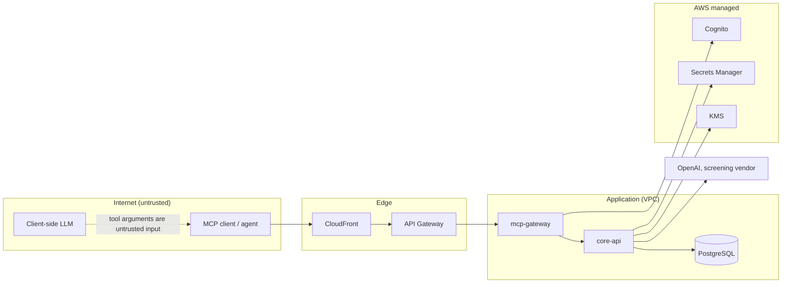
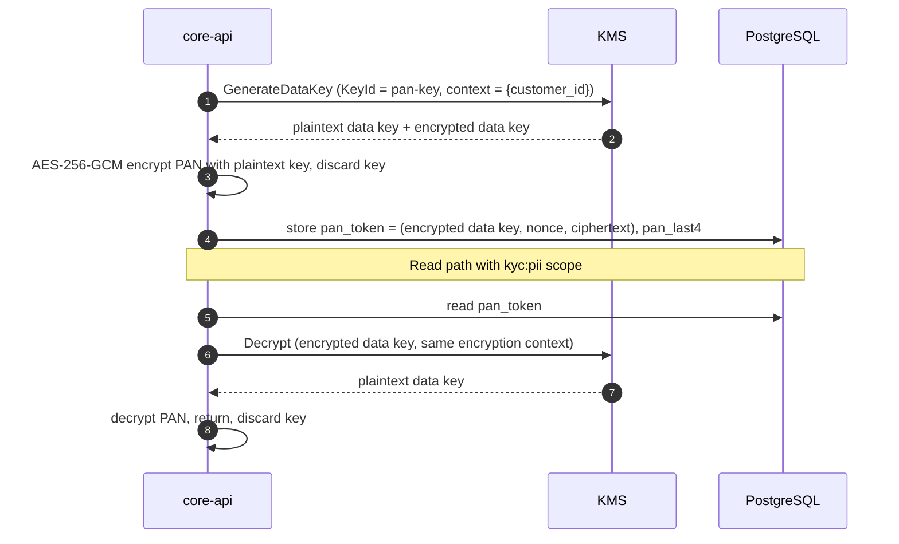

# LLD — Security

All data is synthetic, but the system is built as if it were not. The controls below are what a regulated Indian fintech would expect from a service exposing customer data to AI agents.

## 1. Trust boundaries

*Notice: tool arguments originate from a model that may be manipulated, so they are treated as untrusted input even when the token is valid.*

## 2. STRIDE threat model

| Threat | Example | Mitigation |
|---|---|---|
| **S**poofing | Forged or replayed token | RS256 JWT verification against Cognito JWKS; `iss`, `aud`, `exp`, `token_use` checked; short access-token lifetime (60 min) |
| **S**poofing | Token issued for another resource used here | Audience must equal the gateway resource identifier (RFC 8707 resource indicator) |
| **T**ampering | Altered pagination cursor to read another account | HMAC-signed cursors bound to subject and query hash |
| **T**ampering | Audit rows edited after the fact | `UPDATE`/`DELETE` revoked; hash chain over rows (see §5) |
| **T**ampering | Chaos header injected by a client | HMAC signature, expiry, operator role, disabled in production by default |
| **R**epudiation | "I never raised that dispute" | Audit row per call with `actor_sub`, `client_id`, args hash, outcome, trace ID |
| **I**nformation disclosure | Analyst sees full PAN | Scope `kyc:pii` required; masking at gateway; PAN only decryptable by `core-api` role |
| **I**nformation disclosure | Support agent retrieves restricted SOP | Postgres RLS ceiling per role |
| **I**nformation disclosure | Stack traces or SQL in errors | Error taxonomy returns code + message + trace ID only |
| **D**enial of service | Request flood | CloudFront, API Gateway throttling, per-client token bucket, load shedding |
| **D**enial of service | Expensive queries (huge date ranges) | Input limits (366-day window, page ≤ 100), statement timeout, response byte cap |
| **E**levation of privilege | Prompt-injected agent calls write tools | Write tools need separate scopes, idempotency keys and confirmation; KB tools are read-only |
| **E**levation of privilege | SQL injection via filters | Parameterised SQL only; `ruff` + `bandit` rules ban string-built SQL |

## 3. Identity and access

| Principal | Mechanism | Grants |
|---|---|---|
| Human via MCP client | Cognito authorization code + PKCE via FastMCP OAuth proxy | Scopes from Cognito group (role) |
| Service-to-service (agents in CI, e2e tests) | Cognito client credentials | Scopes fixed on the app client |
| `mcp-gateway` → `core-api` | Private network + shared service token from Secrets Manager (Proposed (to validate in P6): IAM-signed requests via API Gateway private integration) | Full internal API |
| Lambdas → AWS services | Execution roles, least privilege, generated from CDK grants | Per-function |
| GitHub Actions → AWS | OIDC federation, role trust restricted to `repo:<owner>/ledgerlens-mcp:environment:<env>` | Deploy only |

The gateway forwards the verified principal to `core-api` in signed internal headers; `core-api` sets `kosha.actor` and `kosha.kb_ceiling` per transaction.

## 4. Secrets and encryption

| Secret / data | Storage | Rotation |
|---|---|---|
| OpenAI API key | Secrets Manager | Manual, documented runbook |
| Database credentials | Secrets Manager (RDS-managed) | Automatic rotation |
| Cursor HMAC key, chaos HMAC key, service token | Secrets Manager | Dual-key verification window during rotation |
| PAN | KMS envelope encryption | Data key per record, key policy limits decrypt to `core-api` role |
| Data at rest | RDS storage encryption, S3 SSE, SQS SSE, DynamoDB encryption | AWS-managed keys |
| Data in transit | TLS everywhere; `sslmode=verify-full` to RDS | |

PAN envelope encryption:

*Notice: the encryption context binds each ciphertext to its customer, so a token copied onto another customer's row cannot be decrypted.*

Plaintext secrets never appear in environment variables at build time; Lambdas fetch them at cold start through the Parameters and Secrets extension cache.

## 5. Audit log

| Property | Implementation |
|---|---|
| Coverage | Every tool call, including denied and failed ones |
| Content | `actor_sub`, `client_id`, `roles`, `tool_name`, `args_hash` (SHA-256 of canonical args, never raw args), `resource_ids`, `pii_unmasked`, `outcome`, `error_code`, `latency_ms`, `trace_id` |
| Immutability | Application role has `INSERT` only; a `row_hash = sha256(prev_row_hash || row)` chain makes tampering detectable (Proposed (to validate in P3)) |
| Availability | Audit write failures never fail the tool call; they emit a metric with an alarm |

## 6. OWASP Top 10 for LLM applications

| Risk | Relevance to an MCP server | Control |
|---|---|---|
| LLM01 Prompt injection | Retrieved SOP text or customer-entered remarks steer the agent | Content returned as data with source fields, injection heuristics flag suspects, no write capability from KB tools |
| LLM02 Sensitive information disclosure | Agent asks for full PII | Scopes, masking, RLS, minimal fields per view model |
| LLM03 Supply chain | Compromised dependency | `uv.lock` pinned hashes, `pip-audit`, Dependabot, Trivy image scan, minimal base image |
| LLM04 Data and model poisoning | Malicious document ingested | Corpus only from the repository via CI; checksums; classification required in header |
| LLM05 Improper output handling | Tool output rendered as HTML or executed downstream | Structured JSON output; no markup; size caps |
| LLM06 Excessive agency | Agent performs writes the user did not intend | Separate write scopes, idempotency, elicitation confirmation, audit |
| LLM07 System prompt leakage | Prompts expose internal data | MCP prompts contain no secrets or data; templates only |
| LLM08 Vector and embedding weaknesses | Cross-tenant retrieval | RLS ceiling enforced in the database, not in application filters |
| LLM09 Misinformation | Superseded SOP cited as current | Only `effective` documents retrieved by default; every chunk carries version and effective date |
| LLM10 Unbounded consumption | Agent loops on expensive tools | Per-client rate limits, deadlines, page and byte caps |

## 7. Supply-chain and CI controls

| Control | Tool |
|---|---|
| Secret scanning | `gitleaks` (pre-commit and CI) |
| Static analysis | `ruff` (including `S` security rules), `bandit` |
| Dependency audit | `pip-audit` against `uv.lock` |
| Image scanning | Trivy, fail on HIGH/CRITICAL with a fix available |
| IaC policy | `cdk-nag` (AWS Solutions pack) |
| Provenance | Images built in CI only, pushed by digest, deployed by digest |
