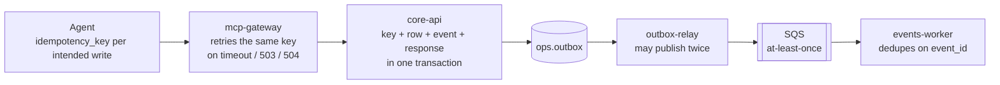

# System design

How LedgerLens answers each standard system-design concern, where the design lives, and whether it is built yet. ✅ means built and tested; a phase (P3–P8) means designed and scheduled there ([plan v1.1](../plans/v1.1-system-design-hardening.md)).

## 1. Coverage

| Concern | Decision | Designed in | Status |
|---|---|---|---|
| **Scalability: compute** | Stateless Lambdas scale horizontally; no session state in any instance | [HLD §4](hld.md#4-deployment-view-aws-eu-north-1) | P6 |
| **Scalability: data** | Monthly range partitions on `core.transactions`; indexes per access path; keyset pagination, so deep pages cost the same as the first | [Data model](lld/data-model.md), [core-api §6](lld/core-api.md#6-pagination-and-filtering) | ✅ |
| **Scalability: connections** | Pool of 2 per `core-api` instance × reserved concurrency 10 = 20 connections, well under the ≈ 100 `db.t4g.micro` allows | [Resilience §5–6](lld/resilience.md#5-bulkhead), §3 below | ✅ pool · P6 concurrency |
| **Availability** | 99.5% SLO; canary deploys with alarm-driven rollback; single-AZ RDS and a NAT instance accepted as cost trade-offs | [HLD §7, §9](hld.md#7-quality-attributes), [Deployment §5](lld/deployment-cicd.md) | P6 |
| **Fault tolerance** | Deadline → bulkhead → breaker → retry with budget → timeout, per downstream; degradation matrix | [Resilience §1–8](lld/resilience.md) | P4 |
| **Self-healing** | Each expected failure has detection, containment, automatic recovery and verification | [Resilience §10](lld/resilience.md#10-self-healing) | ✅ partly · P3–P6 |
| **Rate limiting** | Eight layers: edge flood guard, per-IP, per-principal and per-client token buckets weighted by tool cost, outbound quotas, concurrency ceilings, connection budget; fail soft | [Resilience §6](lld/resilience.md#6-rate-limiting-in-layers), [ADR 0015](../adr/0015-layered-rate-limits-weighted-and-fail-soft.md) | ✅ layer 8 · P3–P6 |
| **Backpressure** | SQS buffers bursts; event-source maximum concurrency caps consumers; load shedding answers `503` rather than queueing | [Async messaging](lld/async-messaging.md), [Resilience §7](lld/resilience.md#7-load-shedding) | P4–P6 |
| **Consistency** | Strong where money moves, eventual where it does not (§2) | [core-api §3–5](lld/core-api.md) | ✅ |
| **Idempotency** | Key, business row, outbox event and stored response in one transaction; consumers dedupe on `event_id` | [ADR 0007](../adr/0007-idempotency-in-the-write-transaction.md), [ADR 0008](../adr/0008-transactional-outbox-and-sqs-no-kafka.md) | ✅ writes · P4 consumers |
| **Concurrency control** | `READ COMMITTED` plus `SELECT … FOR UPDATE` on the rows a write depends on; compare-and-set for rate-limit buckets | [core-api §3–4](lld/core-api.md#3-transaction-boundaries) | ✅ |
| **Caching** | Only what is immutable, public or briefly stale-safe (§4); never balances, Transactions, KYC or search results | §4 below | P3 |
| **Asynchronous processing** | Transactional outbox to SQS; at-least-once delivery, exactly-once effect; DLQs with alarms | [Async messaging](lld/async-messaging.md) | ✅ outbox writes · P4 |
| **Data lifecycle** | Retention and purge per table (§5); partitions created ahead by a scheduled job | §5 below | P6 |
| **Disaster recovery** | RPO ≤ 5 min, RTO ≈ 1 h; infrastructure as code; deterministic reseed for synthetic data (§6) | §6 below | P6 |
| **Security** | OAuth 2.1 with PKCE at the edge; scopes and masking per role; signed internal requests; RLS for knowledge classification; PAN envelope encryption | [Security](lld/security.md), ADRs 0004, 0013, 0014 | ✅ core-api · P3 gateway |
| **Observability** | Structured logs, metrics, traces with one `trace_id`; SLO burn-rate alarms; synthetic probe | [Observability](lld/observability.md), [Resilience §10](lld/resilience.md#10-self-healing) | P3–P6 |
| **API design and evolution** | Versioned paths, one error body, contract snapshots, additive changes only (§7) | [core-api §7](lld/core-api.md#7-openapi), §7 below | ✅ |
| **Deployment safety** | Immutable images, canary 10% for 5 min, automatic rollback, forward-only additive migrations | [Deployment](lld/deployment-cicd.md) | P6 |
| **Testing for failure** | Failure matrix per tool, chaos header, route guards over the contract, load tests | [Plan §8](../plans/v1.0-architecture.md#8-test-strategy), [core-api §8](lld/core-api.md#8-failure-matrix) | ✅ core-api · P3–P6 |
| **Cost** | ≈ $25 a month while running; pause and resume between demos | [HLD §8](hld.md#8-cost-approximate-monthly-while-running) | P6 |

## 2. Consistency model

| Data | Model | Mechanism |
|---|---|---|
| Ledger, balances, disputes, reviews | Strong (serialisable effect) | One ACID transaction per write; row locks; double-entry checked by deferred triggers; cached balance reconciled against postings |
| Domain events | Eventual, at-least-once | Outbox row commits with the business row; relay publishes; consumer dedupes |
| Knowledge base | Eventual | Ingestion pipeline; a document is searchable once its chunks commit |
| Rate-limit buckets | Eventual across instances during a DynamoDB outage | Fail-soft per-instance buckets (ADR 0015) |
| Breaker state | Per instance; fleet override within 5 s | In memory; DynamoDB override cached 5 s |

In PACELC terms the system of record is PC/EC: on a partition (or the database being unreachable) it refuses rather than guesses, and in normal operation it prefers consistency to latency. Everything around it (limits, breakers, events) chooses availability, because none of it holds money.

## 3. Capacity, back of the envelope

| Quantity | Estimate | Consequence |
|---|---|---|
| Demand | 20 active principals × 60 tokens/min ≈ 20 req/s at weight 1 | Fits the 50 req/s API Gateway guard with headroom |
| Gateway concurrency | 20 req/s × 0.3 s p95 ≈ 6 concurrent instances | Reserved concurrency 20 is a ceiling, not a need |
| Database connections | `core-api` 10 × 2 + workers 3 × 2 + relay 1 ≈ 27 | Under the ≈ 100 a 1 GiB RDS instance allows; RDS Proxy not needed |
| Data volume | Full seed: 5,000 Customers, ≈ 1.4 M Transactions, ≈ 5 GB with WAL | 20 GB storage with autoscaling to 40 GB |
| Growth | ≈ 75,000 Transactions a month at the seed's rate | One monthly partition; the 18-month window stays ≈ 1.4 M rows |
| Messages | Tens of events an hour | SQS cost is negligible; one consumer at a time suffices |

## 4. Caching

| What | Where | Lifetime | Invalidation | Why it is safe |
|---|---|---|---|---|
| Cognito JWKS | Gateway memory | 10 min + grace | Refetch on an unknown `kid` (rate-limited) | Public keys; rotation announces itself by `kid` |
| Breaker override | Gateway memory | 5 s | Expiry | A few seconds' delay in a manual override is acceptable |
| Secrets | Parameters and Secrets Lambda extension | 5 min | Refetch on an authentication failure | Rotation keeps the previous value valid briefly |
| KB document by `(doc_code, version, ceiling)` | Gateway memory, LRU | 1 h | None needed: a published version never changes | Keyed by ceiling, so a cached document is only served to callers who could read it |
| Database connections | `core-api` pool | Until the instance is recycled | Checked on checkout | Stale connections are replaced, not used |
| **Never cached** | Balances, Transactions, KYC, AML alerts, search results | — | — | Freshness matters, and visibility differs per caller |

## 5. Data lifecycle

| Data | Retention | How |
|---|---|---|
| `core.transactions` | 18 months online | Monthly partitions created 3 months ahead; older ones detached and archived to S3 |
| `ops.audit_log` | 5 years (PMLA record-keeping) | Append-only; monthly export to S3 with a Glacier lifecycle rule |
| `ops.idempotency_keys` | 24 hours | Daily purge of expired keys; an expired key can also be reclaimed in place |
| `ops.outbox` | 7 days after publication | Daily purge of published rows |
| `ops.processed_events` | 30 days | Longer than DLQ retention (14 days) plus redrive time, so a redriven message still dedupes |
| CloudWatch logs, X-Ray traces | 30 days | Log group retention; X-Ray default |

## 6. Backup and disaster recovery

| Scenario | RPO | RTO | Recovery |
|---|---|---|---|
| RDS host failure | 0 | Minutes | RDS replaces the host automatically (single-AZ) |
| Data corrupted by a bad write | ≤ 5 min | ≈ 1 h | Point-in-time restore to a new instance (7-day backups), switch the secret, `poe migrate` |
| Region or account lost | n/a | Hours | `cdk deploy` rebuilds the stack; synthetic data reloads deterministically with `poe seed` |

A restore drill runs once in P6 and its timings replace these estimates. Multi-AZ RDS would cut host-failure downtime to about a minute, at roughly double the database cost; the trade is recorded in the HLD.

## 7. API evolution

| Interface | Rule |
|---|---|
| `core-api` HTTP | Versioned by path (`/v1`). Changes are additive; a breaking change ships as `/v2` alongside `/v1` until the gateway has moved. The OpenAPI snapshot turns every change into a reviewed diff |
| MCP tools | Inputs and outputs only gain optional fields. A breaking change is a new tool name; the old one is marked deprecated in its description for one release, then removed |
| Events | The envelope carries `event_type` and `schema_version`; consumers ignore unknown fields and route unknown types to the DLQ |
| Database | Forward-only, additive migrations (expand, migrate, contract), so the previous code version still runs during a canary |

## 8. Idempotency, end to end

A write must take effect once however often it is sent, retried or redelivered. Each hop guards its own step:

*Notice: no hop assumes the one before it delivered exactly once; each makes a repeat harmless on its own.*

| Hop | Repeat it can see | Guard | Status |
|---|---|---|---|
| Agent → gateway | The agent retries a write, with the same key or a new one | `idempotency_key` is required on write tools. Same key: replay. New key for the same intent: the domain refuses a second open dispute or review on one Transaction (`409`). Writes also need confirmation (elicitation) and a separate write scope | ✅ domain guard · P3 tool |
| Gateway → `core-api` | Timeout after `core-api` committed | The gateway retries a write **with the same key** on connect errors, `503` and `504` (2 attempts); the retry gets the stored response | P3 |
| Inside `core-api` | Two requests with one key at once | The second waits on the first's uncommitted key row, then replays; a different payload or caller is `409` | ✅ ADR 0007 |
| `core-api` response | Client cannot tell a replay from a first write | `201` first, `200` on replay, plus `Idempotent-Replayed: true` | ✅ |
| Gateway → `/v1/audit` | Retried audit write | The gateway mints `audit_id` per tool call; `core-api` inserts with `ON CONFLICT DO NOTHING` and replays the receipt; the same ID from another caller is `409` | ✅ core-api · P3 gateway |
| Relay → SQS | Crash between send and marking published | Event re-sent with the same `event_id` | ✅ by design |
| SQS → consumer | At-least-once delivery, DLQ redrive | `INSERT INTO ops.processed_events (consumer, event_id) ON CONFLICT DO NOTHING` in the consumer's own transaction; a conflict means skip | ✅ table (revision 0008) · P4 consumer |
| Ledger postings | A reversal posted twice | `UNIQUE (txn_id, txn_initiated_at)` on `ledger.journal_entries`: one entry per Transaction | ✅ |
| Key expiry | Retry after 24 hours | The key is reclaimable, so the domain guard is what stops a duplicate | ✅ |

Keys are namespaced per operation, and the request hash includes the caller: the same key from another principal is a `409`, never someone else's stored response.
