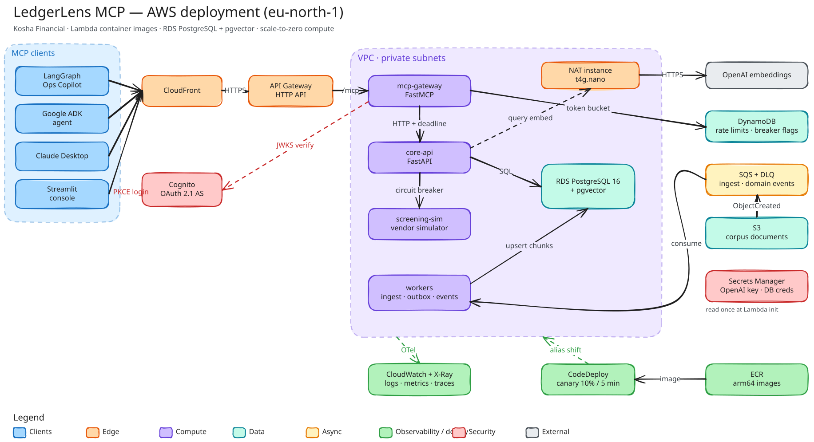
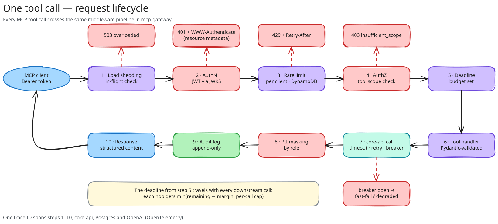
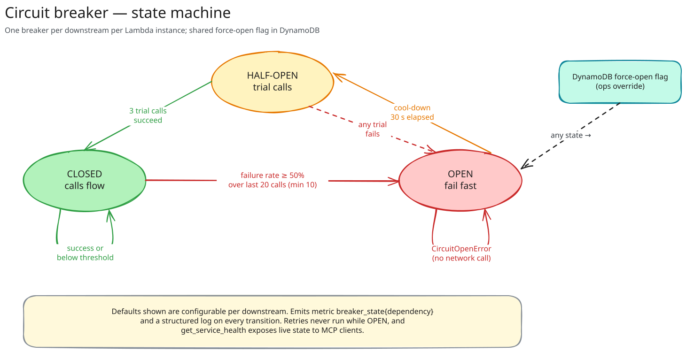
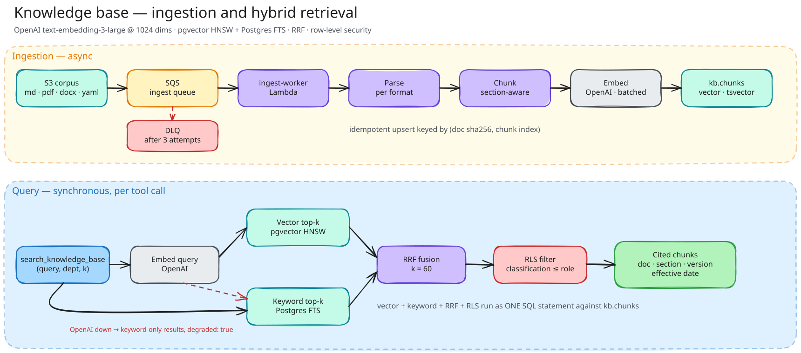
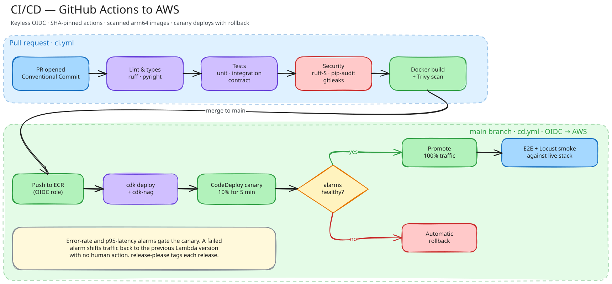

# Diagrams

Hand-drawn [Excalidraw](https://excalidraw.com) diagrams of the system. Each `.excalidraw` source sits next to its rendered SVG, so they can be edited at excalidraw.com (*Open → choose the file*) and re-rendered. They are generated from [`generate_excalidraw.py`](https://github.com/sourav-dhar/ledgerlens-mcp/blob/main/docs/diagrams/generate_excalidraw.py) so layout stays consistent.

## System architecture

Clients reach the gateway through CloudFront and API Gateway; every Lambda runs in private subnets next to PostgreSQL, with egress through a NAT instance.

## Request lifecycle

One tool call through the gateway pipeline: load shedding, authentication, per-client rate limit, scope check, deadline, tool, core API, masking, audit.

## Circuit breaker

Closed, open and half-open states and the conditions that move between them.

## RAG pipeline

Ingestion through SQS into pgvector, and hybrid retrieval with a full-text fallback.

## CI/CD pipeline

From pull request to a canary release that promotes itself or rolls back on alarms.

